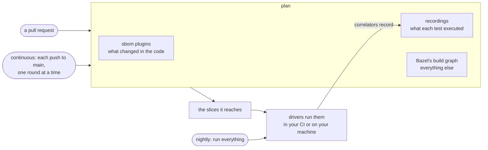

# pipelinegen

pipelinegen makes CI run only the tests a change can reach, including the
ones your build can't see.

Change a backend handler, and the browser tests that call it run, though
no frontend file changed; the browser tests that never reach it don't.
Change a button, and no backend test runs. Every other test of a large
suite stays out of the way, so a pull request waits for a few test files
instead of thousands.

## A twenty-second look

A notes service has a Go backend, Go tests, a web page and two browser
specs. Someone rewords the message the backend's validation returns. Only
two test files can see that change: the Go test of the create route, and
the browser spec that submits the form:

<!-- output: affected-validate -->
```
$ pipelinegen affected --base HEAD~1
pipelinegen affected: lists from the local store (recorded on this machine): /home/you/notes/.git/pipelinegen/local.git
pipelinegen affected: filling the gomodcache cache for go-sbom, go-correlator: go mod download in ., into /home/you/.cache/pipelinegen/repos/notes-2afb52553fae/caches/gomodcache
e2e: 1 selected, 1 untouched
  run e2e/create.spec.ts
go: 1 selected, 4 untouched
  run api/create_test.go
```

And why the browser spec runs, though no file of the page or the spec
changed:

<!-- output: why-validate-create -->
```
$ pipelinegen why --base HEAD~1 --slice e2e/create.spec.ts
pipelinegen why: lists from the local store (recorded on this machine): /home/you/notes/.git/pipelinegen/local.git
e2e e2e/create.spec.ts was selected from 26118462acef to 8933844527a0:
  it executed api.validate during its recording (api/api.go), which changed in this commit
  observed by: go-correlator, oapi-codegen-correlator
```

A change to the API contract reaches the same spec through the
operation, and `why` shows each hop with the plugin that knew it:

<!-- output: why-contract-spec -->
```
$ pipelinegen why --base HEAD~1 --slice e2e/create.spec.ts
pipelinegen why: lists from the local store (recorded on this machine): /home/you/notes/.git/pipelinegen/local.git
e2e e2e/create.spec.ts was selected from 26118462acef to d4d136210ea4:
  it requested POST /notes (createNote) during its recording, which changed in this commit
  it executed notesapi.ServerInterfaceWrapper.CreateNote during its recording (api/notesapi/notesapi.gen.go)
    → which leads to POST /notes (createNote) (a link from oapi-codegen-correlator), which changed in this commit
  observed by: go-correlator, oapi-codegen-correlator
```

pipelinegen knows because plugins read the code (what exists, and what
calls what) and record what each test executed when it ran: the backend
functions, the browser code a spec ran, the SQL statements, the API
operations it called. Those recordings can come from CI or from your own
machine, so a first full CI run is not needed to start narrow. Bazel's
build graph covers every file the plugins don't understand. A nightly run
runs everything and catches whatever a narrower run left out.



## What it needs

- a [Bazel](https://bazel.build) workspace (the book walks you through
  adding one to a Go module);
- a git repository.

That is all on your own machine: `slices`, `check`, `affected`, `why` and
`record` work there with no CI system and no git host, and `seed` puts
your recordings into the repository's store for CI's first runs.

## What it works with today

| | Today |
|---|---|
| CI systems | pipelinegen's steps are commands a CI job calls. A runner plugin writes the whole pipeline from the config; there is one, for [Concourse](https://concourse-ci.org). For another CI system, [run the steps by hand](docs/how-to/any-ci-by-hand.md) in its jobs, or [write a runner](docs/writing-plugins/runner.md). |
| Git hosts | Any git repository. With GitHub it also reports statuses and a comment on pull requests; a plain git server works through the built-in `git` connector. |
| Languages | Plugins for Go, TypeScript and React, npm, PostgreSQL and OpenAPI. Any other language works with the build graph alone. |

[What works today](docs/introduction/what-works-today.md) keeps this
current, release by release.

## Start here

**[The pipelinegen book](docs/README.md)** explains the ideas on one small
example and walks you from nothing to a working pipeline on your own
project. The [contents](docs/SUMMARY.md) list every page. You don't need
a first CI run of everything: record on your machine and [start
narrow](docs/how-to/starting-narrow.md).

**[Converting gavel to pipelinegen](docs/worked-example/README.md)** follows
one real conversion from start to finish: an open source Bazel monorepo
with Go tests, tests that need a database, web checks, the web app's unit
tests and a browser suite, with every command that was run and what each
change then selected.

## Install

Releases are static binaries for Linux and macOS, on amd64 and arm64,
with a `SHA256SUMS` file, on the repository's releases page (macOS since
v0.2.0); [install](docs/tutorial/install.md) shows how to check
them. On other platforms, build from source with Go: `go install
github.com/sideways-works/pipelinegen/cmd/pipelinegen@latest`. While the
repository is private, that needs a git login that can read it and
`GOPRIVATE=github.com/sideways-works/*`.

## Status

pipelinegen is before its 1.0 release: a minor version can change the
config. The [changelog](CHANGELOG.md) lists every release.

## Contributing and licence

[CONTRIBUTING.md](CONTRIBUTING.md) says how to build, test and send a
change; [SECURITY.md](SECURITY.md) how to report a vulnerability.
pipelinegen is licensed under the [Apache License 2.0](LICENSE).
