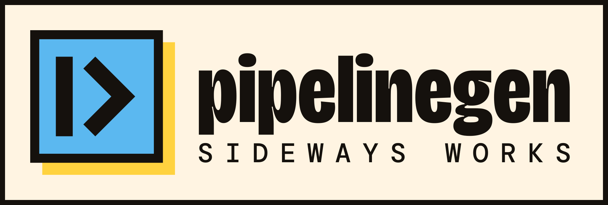
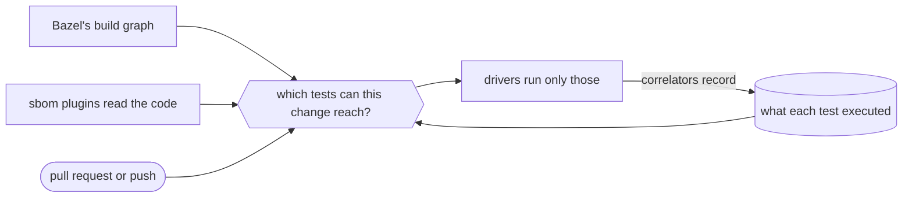

<p align="center">
  
</p>

<p align="center">
  A CI tool that runs only the tests a change can reach, by recording what
  each test touches, and writes the pipeline that does it.
</p>

<p align="center">
  <a href="LICENSE"></a>
</p>

<!-- Screenshot to add here: the comment pipelinegen posts on a pull request
     while its run goes (suites, selected and untouched slices, results), as
     GitHub shows it, in a light and a dark version. -->

Change a backend handler, and the browser tests that call it run, though
no frontend file changed. The browser tests that never reach it don't.
Change a button, and no backend test runs. A pull request waits for a few
test files instead of thousands, and a run of everything each night
catches what a narrower run left out.

## Why pipelinegen

- **It sees links the build can't.** Plugins read the code and record
  what each test executed: backend functions, the browser code a spec
  ran, SQL statements, API operations. A browser spec is tied to the
  handler it called over HTTP, which no build file says.
- **Bazel covers everything else.** A file no plugin understands is bound
  through Bazel's build graph, so any language works with the graph alone.
- **Every choice is explained.** `pipelinegen why` says why a test runs or
  stays out, hop by hop, with the plugin that knew each link.
- **No full first run needed.** Record on your machine with `pipelinegen
  record`, put the recordings into the store with `pipelinegen seed`, and
  the first CI run starts narrow.
- **It writes the pipeline.** A runner plugin turns `pipelinegen.yaml`
  into the whole CI pipeline. On a CI system without a runner, its jobs
  call pipelinegen's steps directly.
- **It runs on your machine.** `check`, `slices`, `affected`, `why`, `run`
  and `record` need no CI system, no git host and no token.
- **Plugins are pinned.** Each plugin is a program fetched from its
  release and checked against its pinned checksum before it runs.

| Works with | Today |
|---|---|
| CI systems | [Concourse](https://concourse-ci.org), through its runner; any other [by hand](docs/how-to/any-ci-by-hand.md) |
| Git hosts | any git repository; on GitHub also statuses and a comment on each pull request |
| Languages | plugins for Go, TypeScript and React, npm, PostgreSQL and OpenAPI; any language through the build graph |

## How it works



On a small notes service with a Go backend and browser specs, a commit
rewords the message the backend's validation returns. Two test files can
see that change, and only those two run:

<!-- output: affected-validate -->
```
$ pipelinegen affected --base HEAD~1
pipelinegen affected: lists from the local store (recorded on this machine): /home/you/notes/.git/pipelinegen/local.git
pipelinegen affected: filling the gomodcache cache for go-sbom, go-correlator: go mod download in ., into /home/you/.cache/pipelinegen/repos/notes-<hash>/caches/gomodcache
e2e: 1 selected, 1 untouched
  run e2e/create.spec.ts
go: 1 selected, 4 untouched
  run api/create_test.go
```

The browser spec runs because its recording reached the changed function:

<!-- output: why-validate-create -->
```
$ pipelinegen why --base HEAD~1 --slice e2e/create.spec.ts
pipelinegen why: lists from the local store (recorded on this machine): /home/you/notes/.git/pipelinegen/local.git
e2e e2e/create.spec.ts was selected from 4c3820d1b492 to 8719e9d00ab8:
  it executed api.validate during its recording (api/api.go), which changed in this commit
  observed by: go-correlator, oapi-codegen-correlator
```

## Quick start

You need Go 1.27, git, [bazelisk](https://github.com/bazelbuild/bazelisk)
on your `PATH`, and Docker or Podman. This runs the small repository in
[`example/`](example/README.md): shell libraries with their tests, and a
Go server with smoke tests.

Install pipelinegen and copy the example into a repository of its own:

```sh
go install github.com/sideways-works/pipelinegen/cmd/pipelinegen@latest
git clone https://github.com/sideways-works/pipelinegen.git
cp -r pipelinegen/example demo && cd demo
git init -q && git add -A && git commit -qm "the example"
pipelinegen check
pipelinegen slices
```

`check` says which files no test covers; on the example it also warns
about the one token its CI config uses. `slices` lists the six test files
in their two suites. Change the library under `calc/` and ask what
that change can reach:

```sh
printf 'sub() {\n\techo $(($1 - $2))\n}\n' >> calc/lib.sh
git commit -qam "calc: add sub"
```

```console
$ pipelinegen affected --base HEAD~1
smoke: 0 selected, 2 untouched
unit: 3 selected, 1 untouched
  run calc/add_test.sh
  run calc/lib_test.sh
  run calc/mul_test.sh
$ pipelinegen why --local --base HEAD~1 --slice calc/add_test.sh
unit calc/add_test.sh was selected from 54c3dd45d954 to 881721f4071c:
  the target //calc:lib.sh changed, through //calc:lib → //calc:add_test
```

`--local` reads recordings from your machine, not from the GitHub
repository the example's config names, which doesn't exist.

Run the three selected test files in their image, as CI would:

```sh
pipelinegen run --base HEAD~1
```

The example binds its tests through the Bazel graph alone. [Running it on
your machine](docs/how-to/running-locally.md) shows the rest, recordings
included, and the [step-by-step guide](docs/tutorial/README.md) sets
pipelinegen up on your own project. Release binaries for Linux and macOS
are on the releases page; [install](docs/tutorial/install.md) shows how to
check them.

## Documentation

[The pipelinegen book](docs/README.md) has everything else. Its
[contents](docs/SUMMARY.md) list every page.

| | |
|---|---|
| [Introduction](docs/introduction/what-it-is.md) | what pipelinegen is, [whether it fits](docs/introduction/is-it-for-you.md), [what works today](docs/introduction/what-works-today.md) |
| [Concepts](docs/concepts/README.md) | every idea, built up on the notes service |
| [Step by step](docs/tutorial/README.md) | your repository from nothing to a working pipeline |
| [Worked example](docs/worked-example/README.md) | one real conversion of an open source Bazel monorepo, every command shown |
| [How-to guides](docs/how-to/README.md) | the tasks of a real setup, such as [starting narrow](docs/how-to/starting-narrow.md) |
| [Reference](docs/reference/config.md) | every [config key](docs/reference/config.md) and [command](docs/reference/commands.md) |
| [Writing plugins](docs/writing-plugins/README.md) | sbom plugins, correlators, drivers, runners and forges |
| [Internals](docs/internals/README.md) and the [design](docs/design.md) | for people who work on pipelinegen itself |

The plugins live in
[pipelinegen-plugins](https://github.com/sideways-works/pipelinegen-plugins).
pipelinegen is before its 1.0 release, so a minor version can change the
config; the [changelog](CHANGELOG.md) lists every release.

## Building and contributing

You need Go (the version in `go.mod`), git, and bazelisk on your `PATH`
as `bazel` too.

| Command | What it does |
|---|---|
| `cp ci/commit-msg "$(git rev-parse --git-path hooks)/commit-msg"` | once per clone: checks each commit message |
| `go build -trimpath ./cmd/pipelinegen` | the program |
| `GOFLAGS=-trimpath go test ./...` | every test; they start Bazel through bazelisk |
| `bazel run //tools:lint` | the lint every commit passes: golangci-lint, then `pipelinegen check` on this repository |
| `bazel run //ci:gate` | a branch's gate before it lands: build, vet, tests, lint and the [proof](docs/proof.md) |

Commits are one conventional subject line of at most 72 characters.
[CONTRIBUTING.md](CONTRIBUTING.md) says how to send a change, and
[SECURITY.md](SECURITY.md) how to report a vulnerability.

## License

pipelinegen is licensed under the [Apache License, Version 2.0](LICENSE),
every folder of it. Third-party notices are in [NOTICE](NOTICE).
