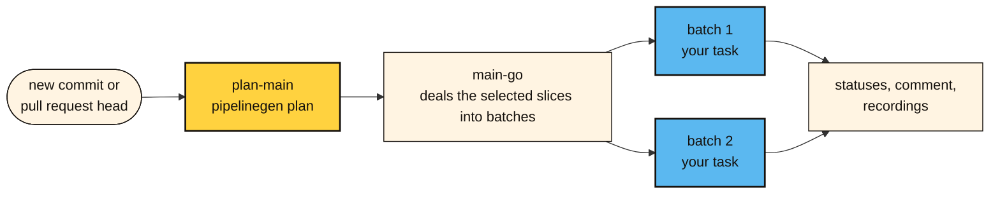

# Runs and the pipeline

## Run

A run is one pass over the selected slices of one change. The config
declares runs by name, and each says four things:

- what starts it (`trigger`): every new commit on a branch, every new head
  of a pull request, a daily timer, or a button;
- what the change is compared with (`compare`): the pull request's target
  branch, the last commit on the branch whose run passed, or nothing;
- what it selects (`select`): the slices the change reaches, or all of
  them;
- which suites it covers, whether it records, and how it reports.

Most repositories want three:

```yaml
runs:
  pr:
    trigger:
      pull_requests: {base: main, draft: false}
    compare: merged_target
    select: affected
    suites: {go: {}}
    record: true
    report:
      comment: {format: list}
  main:
    trigger: {branch: main}
    compare: last_passed
    select: affected
    suites: {go: {}}
    record: true
  nightly:
    trigger:
      timer: {start: "3:00", stop: "4:00", location: Europe/Berlin}
      branch: main
    compare: none
    select: all
    suites: {go: {}}
    record: true
```

The first run on `main` has nothing to compare with, so it runs every
slice and records them all. After that, each commit on `main` runs only
what it reaches since the last commit whose run passed. A slice that
passed at a later commit in the same run, while another slice kept the
run red, is compared from there (the
[`passed-since`](../how-to/narrowing.md#slices-that-passed-since-the-base)
narrowing, off from level 4), so one failing slice doesn't make the
others run again on every commit. Seeding the lists from your machine, or a baseline on a
known good commit, lets it [start narrow](../how-to/starting-narrow.md).

## The runner and the generated pipeline

pipelinegen doesn't run anything itself. A runner plugin turns the config
into a pipeline for your CI system, and the CI system runs it. Today the
one runner is concourse-runner, for [Concourse](https://concourse-ci.org).

The pipeline is generated once and stays the same until the config
changes. Per run it has a planning job and one job per suite:



1. The planning job checks out the change, plans it and stores the plan.
2. Each suite job reads the plan, deals the suite's selected slices into
   batches, and runs your batch task once per batch. A suite with nothing
   selected ends in seconds and passes.
3. Your batch task runs its slices one by one. Around each it calls
   `pipelinegen slice start` and `slice end`, and writes a small result
   file per slice: passed or not, and the end of the output of each failed
   test.
4. As slices end, pipelinegen updates the report and, in a recording run,
   stores what each slice executed.

One more job, `pipeline`, watches the config: when it changes and the
pipeline wasn't set again, that job fails and names the command that sets
it.

A suite job rerun from the CI system's own "rerun" button runs only the
slices that didn't pass.

## Reports

Each suite sets one commit status, `pipelinegen/<run>/<suite>`, and the
run one more, `pipelinegen/<run>`, which a branch protection rule can
require. A pull request run can keep one comment on the pull request,
updated as test files start and end, showing what runs, how much was left
out and what failed, with the failing tests' output.

What a runner for another CI system must do is in [writing a
runner](../writing-plugins/runner.md).

Next: [connectors](connectors.md).
