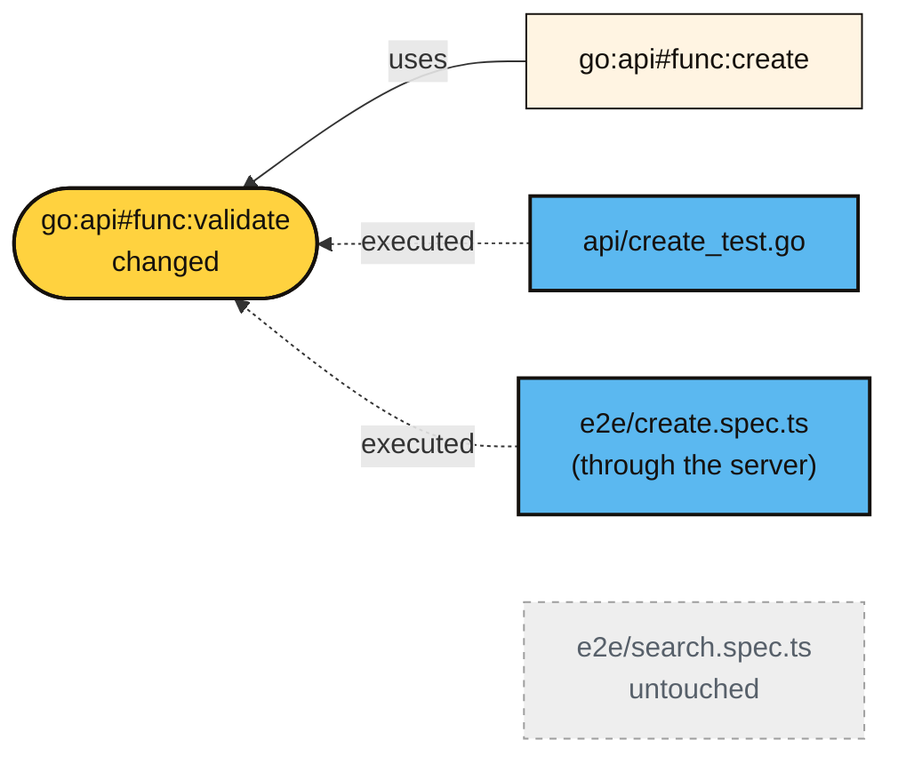

# The graph and the walk

## The graph

pipelinegen puts what the plugins said into one graph. Its nodes are the
units, with their digests; its edges are the links; and every recorded
slice is rooted at the units in its list and at its own files. The graph
is built for both commits of a change, the base and the head.

Building it from scratch for every change would mean every plugin reads
every file every time. Instead, every plugin answer is cached by the
content of the files it was about, under the plugin's version and config.
A plan asks the plugins only about files that changed since an answer was
cached, so the graph stays up to date at the cost of the change. The cache
is shared through the repository ([the store](the-store.md)), so every CI
machine reads the same answers; on your own machine `pipelinegen affected`
keeps a cache of its own.

## What changed

A unit changed when its digest differs between base and head, or when it
exists in only one of them. The edit to `Words` changes one unit,
`go:text#func:Words`. A comment edit changes none.

Files that no plugin describes come from Bazel's side: bazel-diff says
which targets changed, and a slice whose owner's data changed (a fixture,
a config file the test reads) is reached that way. A filegroup in that
data is opened down to its files first, so a file a plugin does describe
(a migration, a message catalog) reaches the slice through its units even
inside a filegroup, and a BUILD file a filegroup lists reaches it only
through the rules it declares
([narrowing](../how-to/narrowing.md#files-inside-filegroups)).

## The walk

From each changed unit, pipelinegen walks the links backwards, toward
whatever uses it, and stops at the slices whose roots it reaches. Take a
backend change: someone rewords the message `validate` returns for a note
without a title. One unit changes, `go:api#func:validate`, and the walk
finds the two slices that executed it, one Go test and one browser spec:



<!-- output: affected-validate -->
```
$ pipelinegen affected --base HEAD~1
pipelinegen affected: lists from the local store (recorded on this machine): /home/you/notes/.git/pipelinegen/local.git
pipelinegen affected: filling the gomodcache cache for go-sbom, go-correlator: go mod download in ., into /home/you/.cache/pipelinegen/repos/notes-<hash>/caches/gomodcache
e2e: 1 selected, 1 untouched
  run e2e/create.spec.ts
go: 1 selected, 4 untouched
  run api/create_test.go
```

No file of the page or the specs changed, yet the spec that submits the
form runs, and the one that only searches doesn't. Each selected slice
carries its reason, the path from the change to one of its roots, and
`pipelinegen why` prints it:

<!-- output: why-validate-create -->
```
$ pipelinegen why --base HEAD~1 --slice e2e/create.spec.ts
pipelinegen why: lists from the local store (recorded on this machine): /home/you/notes/.git/pipelinegen/local.git
e2e e2e/create.spec.ts was selected from 4c3820d1b492 to 8719e9d00ab8:
  it executed api.validate during its recording (api/api.go), which changed in this commit
  observed by: go-correlator, oapi-codegen-correlator
```

and for a slice that stays out:

<!-- output: why-validate-search -->
```
$ pipelinegen why --base HEAD~1 --slice e2e/search.spec.ts
pipelinegen why: lists from the local store (recorded on this machine): /home/you/notes/.git/pipelinegen/local.git
e2e e2e/search.spec.ts was left out from 4c3820d1b492 to 8719e9d00ab8:
  nothing it is bound to changed
  observed by: go-correlator, oapi-codegen-correlator
```

The reverse holds too. A change to the page, `web/index.html`, runs both
browser specs, through their Bazel target, and no Go test:

<!-- output: affected-page -->
```
$ pipelinegen affected --base HEAD~1
pipelinegen affected: lists from the local store (recorded on this machine): /home/you/notes/.git/pipelinegen/local.git
e2e: 2 selected, 0 untouched
  run e2e/create.spec.ts
  run e2e/search.spec.ts
go: 0 selected, 5 untouched
```

The notes service has no API contract, so its specs are tied to the server
through what the server ran. In a repository with an OpenAPI contract,
openapi-sbom and oapi-codegen-correlator also link each request the
frontend makes to its API operation, and each operation to the handler
that serves it.

## How far the walk goes

A test that executed `list` but not `Find` (say a search came back empty
before `Find` ran) could still break when `Find` changes, the next time
the data makes it call `Find`. How far to follow such uses is a setting,
`follow`:

- `executed` (the default) runs a slice when a unit it executed changed,
  or a unit that one of those needs to work (a type it builds, a constant
  it reads). This runs the fewest slices.
- `dependents` also runs a slice that executed anything reaching the
  changed unit through calls or uses. On a server, where the router
  reaches nearly everything, that is often the whole suite.

`follow_depth` limits how many steps `dependents` follows. A suite and a
run can each set their own width, so pull requests can follow what ran
while the main branch follows dependents.

Next: [narrowing](narrowing.md).
