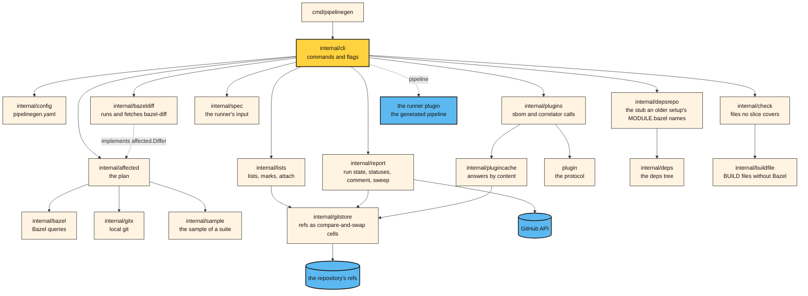

# Internals

For people changing pipelinegen. The design and its reasons are in
[design.md](../design.md), the interfaces between the tool, its parts and a
repository in [contracts.md](../contracts.md); these pages say how the code
carries them out and link to those two for the details.

## The packages and who calls whom

`internal/batch` deals selected slices into batches and
`internal/durations` keeps the seconds per test file they are dealt by.
`internal/gotests` reads a Go test file's test names for the test-file
slices, `internal/recording` is a slice's recording and its marks,
`internal/runs` reads a build's change and applies pull request filters,
`internal/attached` names the runs whose recordings went into a commit's
lists, `internal/secret` masks the token in every error, and
`internal/kit` is the conformance kit behind `pipelinegen plugin test`.
The parts of the plugin protocol that know no kind come from the module
`github.com/sideways-works/plugkit`: calling a plugin and serving a call,
the exchange of a connector's requests, pinned downloads, the container
runner and the kit's harness. `plugin` keeps pipelinegen's kinds and names
plugkit's types as its own, so a plugin built against it builds unchanged.
`internal/testrepo` and `internal/bazeldifftest` serve tests;
`internal/example` tests the example repository;
`internal/docscheck` keeps these docs in step with the code.

`affected` defines the `Differ` interface it needs from bazel-diff, and
`bazeldiff` implements it, so planning can be tested with a fake and with
the real binary alike.

## Plugins

What knows a language, a package ecosystem or a CI system lives in plugins
([plugins.md](../plugins.md)). `internal/plugins` describes the configured
sbom and correlator plugins, has them claim their files, asks for units,
links through the content cache, and assembles the graph of each tree it
plans, which `internal/graph` walks; at slice ends, the same package calls the
correlators' `collect` and `observe`. The pipeline comes from the runner
plugin through `internal/spec`. The core keeps the config, Bazel and
bazel-diff, the stored graph and the walk over it, the narrowing levels and
the sample, plans, refs and reports, and the commands a
pipeline's steps call.

## The pages

- [Planning](planning.md): from two commits to a plan, step by step.
- [Binding by recording](binding.md): recordings, unbound units and
  widths; the deps repository it describes is how a build with the
  `pipelinegen_forward` tag binds slices.
- [The stored graph and the outward walk](graph.md): how planning walks
  outward from what changed.
- [The generated pipeline](pipeline.md): the jobs, the gate, batches,
  reruns, the bootstrap.
- [Refs](refs.md): the layout under `refs/pipelinegen/` and its guarantees.
- [The lock, removed](lock.md): what is left of it for one release.
- [The reporter](reporter.md): states, statuses, the comment, the sweep.
- [Batches](batches.md): dealing by duration, the durations file.
- [Safety](safety.md): why a change can't be missed, and the known limits.
- [Concourse](concourse.md): the facts the design rests on, and how they
  were proven.
- [Testing and releases](testing-and-releases.md).
