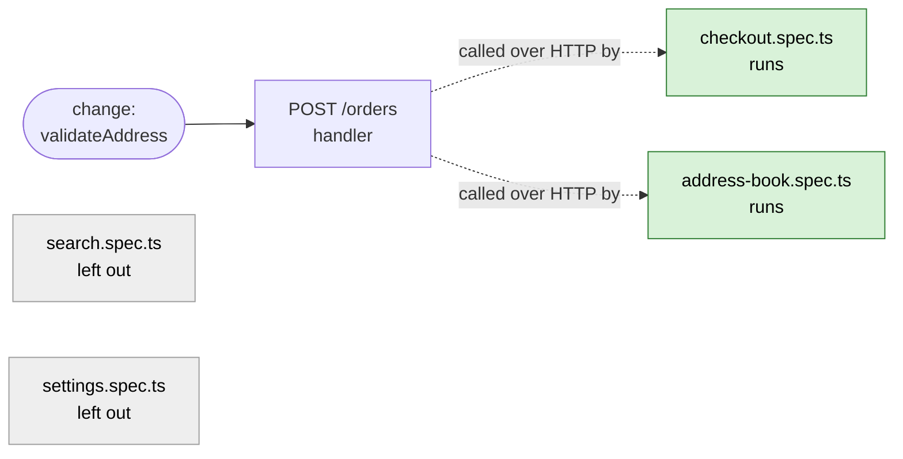

# What pipelinegen is

## CI in a few sentences

Continuous integration (CI) is a service that tests your code every time
someone changes it. You push a commit or open a pull request, a CI system
such as Concourse, GitHub Actions or GitLab CI checks out that commit, and
it runs the steps you described in its config: build, lint, run the tests.
That list of steps is the pipeline. When a step fails, the change is
marked red, and most teams don't merge a red change.

## The first problem: links the build can't see

Picture a web shop with a Go backend and a frontend tested in a browser.
Someone changes how the backend validates a delivery address. No frontend
file changed, yet two browser tests fill in that address form and submit
it, and those two can now fail. A good CI run has to run them, and has no
reason to run the browser tests of the search page or the account
settings.

A build system can't tell you which two. In its graph the browser tests
depend on the frontend app, and the frontend app talks to the backend over
HTTP, which no build file records. So a pipeline that selects tests by the
build graph either runs no browser test for a backend change, which misses
real failures, or is told by hand that the browser tests depend on the
whole backend, and runs all of them for every backend change. The reverse
is just as wasteful: a change to a button's colour has no reason to run a
single backend test.

## The second problem: too many tests

In a large project every change runs thousands of tests. One repository
that uses pipelinegen has about 1,070 test files, 241 of them browser
tests. Running all of them on every change makes a pipeline take an hour,
and people stop waiting for it: they batch several changes into one pull
request, and when it goes red nobody knows which change broke it. Machines
stay busy with tests that couldn't have failed, and a red result arrives
too late to be useful.

Splitting the suite by hand ("only run the frontend tests when `web/`
changed") helps for a while, then drifts. Someone moves a file, a test
starts depending on another service, and a rule quietly stops running a
test it should run.

## What pipelinegen does about them

For the first problem, pipelinegen uses plugins that read your code and
your test runs:

- one kind lists what exists: functions, database tables, API operations,
  modules;
- another says how those pieces connect (this handler calls that function,
  this query reads that table, this frontend call goes to that API
  operation), and, from a recording of each test, which of them the test
  actually executed: backend functions, the browser code a spec ran, SQL
  statements, API operations. A recording comes from CI or from your own
  machine.

So a browser test is tied to the backend functions it reached the last
time it ran, through the requests it made. When one of those functions
changes, that test runs, and `pipelinegen why` says why, hop by hop: what
the test executed, each link followed with the plugin that knew it, and
what changed. The [concepts](../concepts/README.md) show it on a small
notes service, where an edit to the backend's validation runs the one
browser spec that submits the form and leaves the one that only searches.

For the second problem, pipelinegen plans every change: it compares the
change with the last commit that passed and selects only the test files
the change can reach. The build graph ([Bazel](https://bazel.build)) says
which files belong together; the plugins say what each test depends on at
run time. Everything else is reported as left out. A run that selects
three test files pays for three, so a small fix waits for a few tests
instead of all of them, and every pull request gets a signal of its own.

When pipelinegen can't be sure what a change reaches, it runs more, never
less: a change to the build setup, a file nothing describes, or a test
that has never been recorded runs everything it might touch. A nightly run
runs every test regardless and catches whatever the selection left out.

pipelinegen also writes the CI pipeline for you, from one small config
file, and reports on the change: a status per suite of tests, and on a
pull request one comment that follows the run test file by test file.

## What it is not

pipelinegen doesn't run your tests itself and doesn't know what `go test`
or Playwright is. Your own CI tasks run them; pipelinegen tells each task
which test files to run and reads a small result file back. It doesn't
edit your BUILD files, and nothing it generates is checked in.

See it on a small service in [the concepts](../concepts/README.md), and on
a real project in the [worked example](../worked-example/README.md).

Next: [is it for you?](is-it-for-you.md)
