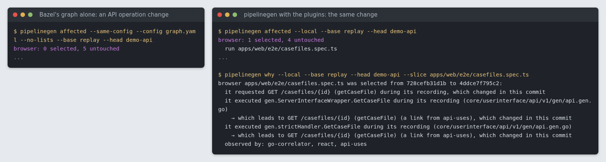

# Converting gavel to pipelinegen

> Where the conversion stands: made with v0.2.0. gavel's config pins
> pipelinegen v0.2.0 and the v0.2.0 releases of its runner, plugins and
> drivers, and all five suites name steps run by drivers, with no batch
> script left. The numbers on this page were measured with the last
> candidate, v0.1.13-rc.18, whose code v0.2.0's tool is plus the fixes
> listed in the changelog's 0.2.0 entry; none of them changes what a plan
> selects. On a developer's machine, with those releases: the `go` suite was recorded whole (289 of
> 289 test files passed), the `go-db` suite's 18 files passed, the `web`
> suite's 2 checks and the `vitest` suite's 56 files passed, and the 5
> browser specs passed, both run plainly and recorded. The pipeline runs
> on a fork of gavel, green on 2026-11-16 at its commit `6c20a55`: there
> the go, go-db, web and vitest suites pass and record, and the browser
> specs pass but don't record yet (step 10 says why).
> The table of fifteen commits and the three changes at the top were
> measured again with v0.1.13-rc.18, and so were step 4's check and step
> 5's plans.

This page follows one real conversion from start to finish. The project is
[gavel](https://github.com/gavelcode/gavel), an open source code quality
tool for Bazel monorepos, at its commit `365aa7a`. The files the
conversion adds are in [gavel/](gavel/) next to this page, as they stand
on the fork's branch `pipelinegen`.
Nothing here assumes you know what a CI pipeline is beyond "the machine
that runs the tests when someone pushes", or what pipelinegen does.

gavel is young and small: about 150 commits, 1,646 files, 147 test targets.
That makes it easy to follow, and it means a full run costs minutes here,
so what a change saves is minutes too. The section [what would differ on a
large monorepo](#what-would-differ-on-a-large-monorepo) says what changes
with size.

## What you will see

A one-line change inside one of gavel's Go HTTP handlers, the one that
serves a single case file. gavel's own CI runs all 147 of its test targets
for it, and none of its browser specs, which aren't part of its CI. After
the conversion the change runs the three Go test files that exercise that
handler and one of the five browser specs, the one whose page calls it,
and `pipelinegen why` says so. (It also runs four Go test files whose
recordings can't say what they depend on, on every change that changes
any code; [before and after](#before-and-after-on-fifteen-real-commits)
says which and why.) This and the three changes below were measured again
with the last development build and gave the same selections as with the
earlier one; the pictures are from the earlier measurement.


No file of the web app changed. The link from that handler to that browser
spec is in no build file; pipelinegen learned it by recording what the
server ran while each spec ran.

## What gavel is

gavel is a command line tool and a server. The command, `gavel judge`, runs
linters and coverage as Bazel aspects over a repository and fails a change
that makes things worse. The server keeps the results, serves a REST API
described in OpenAPI, and ships a React web app. The repository holds:

| Directory | What it is |
|---|---|
| `apps/cli`, `apps/server` | the two binaries and their integration and end-to-end tests |
| `apps/web` | the React 19 web app (Tailwind), built by Bazel with esbuild, and its vitest and Playwright tests |
| `core/` | the code both binaries share, in four layers: `domain`, `application`, `infrastructure`, `userinterface` |
| `core/infrastructure/platform/database/migrations` | PostgreSQL migrations (goose), embedded in the server |
| `openapi/v1` | the API contract, split over several files; `oapi-codegen` generates the Go server from it |
| `tools/` | a second Go module with two generators and their tests |
| `examples/` | four small Bazel workspaces of their own, which gavel's CI judges to prove onboarding works |

It builds with Bazel 9.1 and bzlmod, Go 1.25, rules_go, gazelle and
aspect's rules_js and rules_ts.

## How its CI works today

gavel runs GitHub Actions on every push to `main` and every pull request.
The job that matters here is `test`:

```yaml
- name: Build
  run: bazel build //...
- name: Test
  run: bazel test //...
```

`bazel test //...` runs every test target of the workspace, whatever the
change touched. There are 147: 145 `go_test` targets and the web app's type
check and lint. A pull request that fixes a typo in a README runs all 147,
and so does a one-line fix in the CLI.

Bazel caches test results, so on a warm machine an unchanged target is
not run again. CI machines are often cold, and a change to a package low in
the graph (the domain model, say) invalidates most targets anyway. And the
cache only knows that a target's inputs changed. It can't know that the
change touched only a comment, which go-sbom's digests ignore
([step 6](#step-6-bind-the-go-tests-by-what-they-ran)), or that most test
files of a package never call the function that changed, which the
recordings tell ([step 8](#step-8-a-first-recording-on-your-machine)).

A cold run with `--jobs=4`, on a shared machine that was busy with other
work:

```
$ bazel test //... --jobs=4
INFO: Analyzed 311 targets (890 packages loaded, 29588 targets configured).
...
INFO: Elapsed time: 764.075s, Critical Path: 352.51s
Executed 147 out of 147 tests: 147 tests pass.
```

Three kinds of tests never run in that job: 56 vitest files of the web app
(another job runs them only to measure coverage), five Playwright specs,
and seven Go files behind the build tag `e2e` that drive the built binaries.
The last ones have no Bazel target at all; the developers run them with a
script.

## What the conversion buys, in three changes

The clearest way to see what pipelinegen does is to watch three small
changes to gavel and what each one runs. Each is one commit on a branch of
its own (`demo-go`, `demo-api`, `demo-web`) on top of the converted tree
(the branch `replay` of [step 5](#step-5-try-it-on-the-projects-own-history),
whose last commit holds the same files as `365aa7a` plus the conversion).
Each is planned twice: with the plugins and the recordings of
[step 8](#step-8-a-first-recording-on-your-machine), and with every suite
bound by Bazel's graph alone. The browser specs are the interesting part:
five Playwright files that log in, open the web app and click through it,
against the real Go server and PostgreSQL.

| Change | Bazel's graph alone runs these browser specs | pipelinegen with the plugins runs |
|---|---|---|
| the "not found" message in `Handler.GetCaseFile`, the Go handler that serves one case file (`core/userinterface/api/v1/server/casefile/handler.go`) | all 5 | 1: `casefiles.spec.ts` |
| an optional parameter on `getCaseFile`, the API operation that returns one case file (`openapi/v1/casefile/casefile.yaml`) | none | 1: `casefiles.spec.ts` |
| how the web app's client function `getCaseFile` builds that operation's URL (`apps/web/src/entities/casefile/api.ts`) | all 5 | 1: `casefiles.spec.ts` |

The first row is the one from the top of the page. No file of the web app
changed, yet the spec that opens a case file runs, and the four that never
do stay untouched. The server recorded which of its functions each spec
reached, and `pipelinegen why` says so:

```
$ pipelinegen why --local --base replay --head demo-go --slice apps/web/e2e/casefiles.spec.ts
browser apps/web/e2e/casefiles.spec.ts was selected from f7dbbddba75b to 4365b2ee47f9:
  it executed casefile.Handler.GetCaseFile during its recording (core/userinterface/api/v1/server/casefile/handler.go), which changed in this commit
  observed by: go-correlator, react, api-uses
```

The second row is the one the graph gets wrong the other way. gavel's Go
server is generated from the contract by `oapi-codegen`, and the generated
code is checked in, so in Bazel's graph the contract's YAML files reach
only the one test that checks the contract itself. A change to an operation
runs no handler test and no browser spec. pipelinegen knows which
operations each spec requested, and which generated code serves each
operation:



```
$ pipelinegen why --local --base replay --head demo-api --slice apps/web/e2e/casefiles.spec.ts
browser apps/web/e2e/casefiles.spec.ts was selected from f7dbbddba75b to b36dbe7dffc1:
  it requested GET /casefiles/{id} (getCaseFile) during its recording, which changed in this commit
  it executed gen.ServerInterfaceWrapper.GetCaseFile during its recording (core/userinterface/api/v1/gen/api.gen.go)
    → which leads to GET /casefiles/{id} (getCaseFile) (a link from api-uses), which changed in this commit
  it executed gen.strictHandler.GetCaseFile during its recording (core/userinterface/api/v1/gen/api.gen.go)
    → which leads to GET /casefiles/{id} (getCaseFile) (a link from api-uses), which changed in this commit
  observed by: go-correlator, react, api-uses
```

The third row is the same idea on the browser's side. Only
`casefiles.spec.ts` ever ran the client's `getCaseFile` in Chromium, so
only it runs; the four others ran other functions of the same file, which
`why` says too:


```
$ pipelinegen why --local --base replay --head demo-web --slice apps/web/e2e/auth.spec.ts
browser apps/web/e2e/auth.spec.ts was left out from f7dbbddba75b to d34f256566a3:
  the narrowing ts-functions left it out: ts:apps/web/src/entities/casefile/api.ts#fn:getCaseFile changed, which only the wide rule binds to these slices; it would have run at narrowing level 4 or above (the plan used 3)
  observed by: go-correlator, react, api-uses
```

"Narrowing level" is how much pipelinegen trusts what it recorded: at the
default, 3, a spec runs when a function it ran changed; from level 4 on,
when anything in the same file changed. [Narrowing](../concepts/narrowing.md)
has the levels.

The rest of this page shows how gavel got there, step by step.

## The idea in one paragraph

pipelinegen turns every test file into a *slice*: something that is
selected, run and reported on its own. For each change it works out which
slices the change can reach and runs only those. It learns what a change
reaches in two ways. Bazel's build graph says which targets a change
touches (pipelinegen asks [bazel-diff](https://github.com/Tinder/bazel-diff),
which compares the graph at two commits). Plugins add what the graph can't
see: which functions each test file actually ran the last time it ran,
read from coverage. A slice runs when something it depends on changed;
everything else is reported as untouched. Once a night everything runs, as
a net under the selection. [What pipelinegen is](../introduction/what-it-is.md) and
[concepts](../concepts/README.md) explain the terms used below: suite, slice,
batch, run, plan, recording, list.

## What you need

- a Bazel workspace with bzlmod (gavel has it);
- `pipelinegen` and `bazelisk` on your machine; pipelinegen downloads its
  pinned bazel-diff by itself;
- the plugins of your languages: here go-sbom and go-correlator for Go,
  ts-sbom, react-correlator and npm-sbom for the web app, openapi-sbom and
  oapi-codegen-correlator for the API contract;
- for the browser specs on your machine: Docker, Go, Node 22.18 or newer
  with npm, and the Chromium of the app's Playwright version;
- Concourse to run the pipeline it writes, and a GitHub repository for the
  statuses, the pull request comment and the run state. Both are configured
  in one place near the end, [step 10](#step-10-the-runs-and-the-pipeline-github-and-concourse),
  and nothing before it needs either.

The conversion added these files to gavel, all of them in [gavel/](gavel/)
beside this page:

| File | What it is |
|---|---|
| [`pipelinegen.yaml`](gavel/pipelinegen.yaml) | the config: suites and the steps that run them, plugins and drivers, runs, what needs no test |
| [`ci/root.yml`](gavel/ci/root.yml) | the images the suites' tasks run in, as resources of the pipeline |
| [`apps/web/e2e/recording.ts`](gavel/apps/web/e2e/recording.ts), [`apps/web/playwright.pipelinegen.config.ts`](gavel/apps/web/playwright.pipelinegen.config.ts) | what a recording run adds to the browser specs, and the config the batch runs them with |

and changed these:

| File | Change |
|---|---|
| `apps/web/BUILD.bazel` | two tagged filegroups, one per web check, and one for the files every browser spec shares |
| `apps/web/e2e/fixtures.ts`, `auth.spec.ts` | the specs take `test` from the shared helper, which wraps it in a recording run |
| `apps/web/e2e/global-setup.ts`, `start-server.sh` | brought up to date with the server (see [what did not fit yet](#what-did-not-fit-yet)) |
| `.gitignore` | `/tools/plugins/`, where the plugins lie on your machine |

No BUILD rule of gavel's own changed, and no test's assertions.

## Step 1: a branch and the tools

Work on a branch of your own; nothing in the conversion touches how the
project builds today, so the old CI keeps working while you try.

Install pipelinegen from a release and check it against the release's
checksum ([install](../tutorial/install.md) has the commands), and put
bazelisk on your `PATH`. The config beside this page pins:

```
$ pipelinegen version
v0.2.0
```

First make sure the project's own tests pass on your machine, so that a
red test later is pipelinegen's doing and not the project's:

```
$ bazel test //... --jobs=4
Executed 147 out of 147 tests: 147 tests pass.
```

gavel's `.bazelrc` adds a second module registry next to the central one:

```
common --registry=https://gavelcode.github.io/registry
common --registry=https://bcr.bazel.build
```

Look at what such a registry serves before your first build: it is listed
first, so it can replace any module of the central registry, and every
module it serves becomes part of the build graph that pipelinegen plans
by. gavel takes one module from it, `gavel_tools` (`bazel_dep(name =
"gavel_tools", version = "0.3.8")`), whose macros build the web app and
whose files some Go tests read ([step 4](#step-4-the-check-and-every-file-accounted-for)).

## Step 2: the smallest config and the slices

`pipelinegen.yaml` sits at the repository's root. The smallest useful one
names the Bazel workspace and one suite:

```yaml
pipeline: gavel

bazel:
  workspace: .
  bazelisk: bazelisk

plugins:
  - name: go
    kind: driver
    repository: sideways-works/pipelinegen-driver-go
    release: {version: v0.2.0, sha256: ea8ef7dbb3b6b8d14fddd3342ab4c6090e0818d8d44b878dcb51ca0cf4720e76}

suites:
  go:
    tests: ["**/*_test.go"]
    steps:
      - run: go
```

A *suite* is one kind of test with one way to run it. `tests` says which
files are its test files, and each of them that holds a test of its own is
a slice, named by its path. `steps` says how its slices run: here one run
step, by the go driver, a plugin pinned like every other
([drivers](../concepts/drivers.md)); step 7 gives each suite the steps it
needs. Ask for the list:

```
$ pipelinegen slices --suite go
go apps/cli/internal/app/root_test.go
  apps/cli/internal/app/root_test.go
go apps/cli/test/e2e/config_test.go
  apps/cli/test/e2e/config_test.go
...
```

314 slices. Read the list before you go on. The four test files under
`examples/go-repo` are not in it: that directory is a separate Bazel
workspace that `.bazelignore` hides from the main one, and a test file no
Bazel target can hold is no slice. One thing in the list was wrong for
gavel: the six files under `apps/cli/test/e2e/` and one under
`apps/server/test/e2e/` start with `//go:build e2e` and have no Bazel
target. They drive the built binaries, and they don't build today (see
[what did not fit yet](#what-did-not-fit-yet)), so they get no suite: the
`go` suite leaves them out, and step 4 lists them as `untested` until they
build.

Go test files without a top-level `Test` function, such as
`helpers_test.go`, are helpers, not slices; pipelinegen finds them by
itself.

## Step 3: decide the suites

A suite is worth its own entry when its tests need a different setup.
gavel's tests that build fall into five groups. Three come first; the
browser specs and the web app's unit tests join in step 9.

| Suite | Test files | Why apart | How they run |
|---|---|---|---|
| `go` | 289 `_test.go` files | need only Go | the go driver: `go test` of the file's own tests |
| `go-db` | 18 files in the 9 packages whose tests start PostgreSQL through testcontainers | need a Docker daemon, so the task runs privileged | the go driver, after a set-up starts `dockerd` |
| `web` | the web app's type check and lint | they are Bazel test targets, not files | the shell driver: `bazel test` of each target |
| `browser` (step 9) | 5 Playwright specs | need the server, PostgreSQL and a browser | the playwright driver, one spec at a time, against one server built with coverage |
| `vitest` (step 9) | 56 test files of the web app | need Node and the app's packages | the shell driver: vitest, a batch's files in one run |

The `go-db` split is by package rather than by file. In those packages
only some files call the database helper, but a new test in such a package
most likely will too, and it would silently skip in a suite without Docker
(gavel's helper skips its tests when no container runtime answers).

In the config:

```yaml
suites:
  go:
    tests: ["**/*_test.go"]
    exclude:
      # the Go end-to-end tests don't build today: untested, below
      - "apps/cli/test/e2e/*_test.go"
      - "apps/server/test/e2e/**"
      # the database tests are the go-db suite
      - "core/infrastructure/*/postgres/*_test.go"
      - "core/infrastructure/platform/database/*_test.go"
      - "core/infrastructure/platform/sourceblob/*_test.go"
      - "core/infrastructure/supporting/search/*_test.go"
      - "apps/cli/test/integration/submit/*_test.go"
    steps: [...]                      # step 7

  go-db:
    tests: ["core/infrastructure/*/postgres/*_test.go", "core/infrastructure/platform/database/*_test.go", "core/infrastructure/platform/sourceblob/*_test.go", "core/infrastructure/supporting/search/*_test.go", "apps/cli/test/integration/submit/*_test.go"]
    privileged: true
    steps: [...]

  web:
    tag: slice-web
    steps: [...]
```

`web` is a *tagged* suite: its slices are Bazel targets that carry the tag
`slice-web`. The two checks come out of a macro, `web_project`, that takes
no tags and makes the test targets `//apps/web:web.typecheck` and
`//apps/web:web.lint` (`bazel query 'tests(//apps/web/...)'` lists them), so
`apps/web/BUILD.bazel` gets two small filegroups that carry the tag and
name the target that runs them:

```starlark
filegroup(
    name = "typecheck_slice",
    srcs = [":web.typecheck"],
    tags = [
        "pipelinegen-run://apps/web:web.typecheck",
        "slice-web",
    ],
)

filegroup(
    name = "lint_slice",
    srcs = [":web.lint"],
    tags = [
        "pipelinegen-run://apps/web:web.lint",
        "slice-web",
    ],
)
```

A change reaches a filegroup exactly when it reaches its check, since the
filegroup holds it.

```
$ pipelinegen slices | grep -v '^ ' | awk '{print $1}' | sort | uniq -c
    289 go
     18 go-db
      2 web
```

(`slices` prints each slice's files indented below it; `grep -v '^ '`
keeps the slice lines alone.)

## Step 4: the check, and every file accounted for

Selection is only safe when a change to any file reaches the tests that
could break. `pipelinegen check` makes sure every tracked file is either
something a slice depends on or listed as needing no test, with a reason.
It reads BUILD files and git without starting Bazel, so it takes a fraction
of a second and fits a commit hook.

The first run on gavel, with the suites of step 3 (measured with the last
development build on the converted tree, which also holds the files later
steps add, such as `ci/root.yml`):

```
$ pipelinegen check
.bazelignore: no slice depends on this file, so a change to it would run nothing
  fix: add it to the srcs or data of a target a slice depends on, or to untested in pipelinegen.yaml with a reason
.bazelrc: no slice depends on this file, so a change to it would run nothing
  fix: ...
...
pipelinegen check: 321 findings: did not pass
```

321 findings sounds like a lot, but they fall into a handful of groups, and
each group is one decision. `--summary` counts them by top-level directory:

```
$ pipelinegen check --summary
224	uncovered-file	apps/
43	uncovered-file	docs/
20	uncovered-file	.
15	uncovered-file	.gavel/
7	uncovered-file	.github/
4	uncovered-file	examples/
3	uncovered-file	core/
3	uncovered-file	tools/
1	pinned-by-version (warning)	.
1	uncovered-file	ci/
1	uncovered-file	hack/
322 findings
pipelinegen check: 321 findings: did not pass
```

The count line includes the warning; the last line counts what fails.
`examples/` shows as four findings, one per directory `.bazelignore` hides
(203 files), since nothing in them can be covered.

For gavel the groups and the decisions were:

| Files | Decision | Why |
|---|---|---|
| `examples/**` | `untested` | separate workspaces, judged by gavel's own onboarding job, not by these tests |
| `docs/**`, `*.md`, `LICENSE`, `glama.json` | `untested` | read by people only |
| `.github/**`, `.gitignore` files, `codecov.yml` | `untested` | repository settings and the old CI |
| `.gavel/architecture.yml`, `.gavel/baseline/**`, `.gavel/gavel.bazelrc`, `.golangci.yml` | `untested` | gavel's own baseline and lint settings, read when gavel judges itself; `.bazelrc` imports `gavel.bazelrc`, but it holds only named configs (`build:gavel ...`) that a plain `bazel test` doesn't use |
| `.gavel/gavel.MODULE.bazel` | `everything_on` | `MODULE.bazel` includes it, so it is build setup like `MODULE.bazel` itself |
| `.goreleaser.yaml`, `hack/release.sh`, `install.sh`, `Makefile` | `untested` | release and developer scripts |
| `MODULE.bazel`, `.bazelversion`, `.bazelrc`, `.bazelignore`, `go.mod`, `go.sum`, `go.work`, `go.work.sum`, `tools/go.mod`, `tools/go.sum`, `tools/BUILD.bazel`, `apps/web/package.json`, `apps/web/pnpm-lock.yaml` | `everything_on` | the build setup: a change to it can break any test, so it runs every slice |
| `pipelinegen.yaml` | neither | the planner judges a change to the config by what it means ([a change to this file](../reference/config.md#a-change-to-this-file)): a suite's changed steps run that suite's slices, a comment runs nothing |
| `apps/server/cmd/gavel-server/*.go`, `apps/server/internal/platform/frontend/*.go` | the browser suite of step 9 | only tests that start the server binary run them, and of those only the browser specs build; go-sbom claims the files, and the specs' recordings bind them |
| `apps/server/cmd/gavel-server/BUILD.bazel`, `apps/server/internal/platform/frontend/BUILD.bazel` | `untested` | the server's Bazel build, which no test runs: the browser suite builds the server with `go build` |
| `apps/cli/test/e2e/*_test.go`, `apps/server/test/e2e/*_test.go` | `untested` | the Go end-to-end tests, which don't build today; they join a suite when they do |
| e2e `run.sh`, `devdemo.sh`, `apps/server/testdata/**` | `untested` | scripts and sample data for running things by hand |
| `apps/cli/BUILD.bazel`, `core/domain/iam/model/BUILD.bazel`, `core/userinterface/api/v1/server/supporting/BUILD.bazel` | `untested` | BUILD files that declare no target |
| `apps/web/tokens.json`, `apps/web/scripts/generate-tokens.mjs` | `untested` | design tokens a developer script exports from `src/index.css`; nothing in the build reads them |
| `core/userinterface/api/v1/gen/oapi-codegen.yaml` | `untested` | the generator's settings; its output is checked in and tested |
| `apps/web/src/**` and the app's config files | read by a macro, below | |
| `apps/web/e2e/**`, `playwright.config.ts`, `vitest.config.ts` | the suites of step 9 | |

`untested` and `everything_on` look like this in the config:

```yaml
everything_on:
  - MODULE.bazel
  - .gavel/gavel.MODULE.bazel
  - .bazelversion
  - .bazelrc
  - .bazelignore
  - go.mod
  - go.sum
  - go.work
  - go.work.sum
  - tools/go.mod
  - tools/go.sum
  - tools/BUILD.bazel
  - apps/web/package.json
  - apps/web/pnpm-lock.yaml

untested:
  - paths: ["examples/**"]
    reason: separate Bazel workspaces (in .bazelignore) that gavel's onboarding job judges; no test of this workspace reads them
  - paths: ["docs/**", "**/*.md", LICENSE, glama.json]
    reason: prose and listings, read by people only
  - paths: [".github/**", .gitignore, "**/.gitignore", codecov.yml]
    reason: repository settings and the old CI
  - paths: [".gavel/architecture.yml", ".gavel/baseline/**", .gavel/gavel.bazelrc, .golangci.yml]
    reason: gavel's own baseline and lint settings, read when gavel judges itself
  - paths: [.goreleaser.yaml, hack/release.sh, install.sh, Makefile]
    reason: release and developer scripts
  - paths: ["apps/cli/test/e2e/*_test.go", "apps/server/test/e2e/*_test.go"]
    reason: Go end-to-end tests that do not build today (build tag e2e); they join a suite when they do
  - paths: [apps/cli/test/e2e/run.sh, apps/server/test/e2e/run.sh, apps/server/test/e2e/devdemo.sh, "apps/server/testdata/**"]
    reason: scripts and sample data for running things by hand
  - paths: [apps/cli/BUILD.bazel, core/domain/iam/model/BUILD.bazel, core/userinterface/api/v1/server/supporting/BUILD.bazel]
    reason: BUILD files that declare no target
  - paths: [apps/web/src/assets/hero.png, apps/web/src/assets/vite.svg]
    reason: images no source of the app imports
  - paths: [apps/web/tokens.json, apps/web/scripts/generate-tokens.mjs]
    reason: the design tokens exported from src/index.css by a developer script; nothing in the build reads them
  - paths: [core/userinterface/api/v1/gen/oapi-codegen.yaml]
    reason: the generator's settings; its output is checked in and tested
```

The difference between the two matters. A file in `untested` runs nothing
when it changes; a file in `everything_on` runs everything. When in doubt,
ask what breaks if the file is wrong. A broken README breaks no test; a
broken `.bazelrc` can break all of them.

The `go.mod` entries are for this first version of the config, where tests
are bound by the Bazel graph alone. Step 6 takes them out again.

The web app needs one more entry. `apps/web/BUILD.bazel` builds the app
with a macro, `web_project`, that comes from another module. The check
can't look inside another repository's macro, so the config says which
files of the calling package it reads:

```yaml
macros:
  "@gavel_tools//macros:web.bzl%web_project":
    reads: ["src/**/*.ts", "src/**/*.tsx", "src/**/*.css", "public/**", index.html, "tsconfig*.json", eslint.config.js, tailwind.config.js]
    reason: bundles, styles, type-checks and lints the app's sources
```

Take the patterns as narrow as the macro reads. The plan holds the
declaration against what Bazel says the macro's targets read, and fails a
plan whose patterns claim more. With `src/**`, the first plan of step 5
stops at once:

```
pipelinegen try: try 365aa7a69175: a macros declaration claims files the macro doesn't read: macros "@gavel_tools//macros:web.bzl%web_project": reads "src/**" claims apps/web/src/assets/hero.png, apps/web/src/assets/vite.svg for //apps/web:web, and Bazel says nothing //apps/web:web made reads them; the check counts them as covered, so a change to them may run nothing
```

which is why the two images are `untested` above.

With that, the plugins of step 6 and the suites of step 9 in place, the
check passes. It still prints the macro declaration, so it stays in sight,
the Go module files it leaves to go-sbom (step 6), and one more warning
(the picture is from the earlier development build; the last one prints
the same, and also leaves to go-sbom the server's three Go files that only
the browser specs run, `apps/server/cmd/gavel-server/main.go`,
`tenant_commands.go` and
`apps/server/internal/platform/frontend/frontend.go`):


The CLI binary takes `@gavel_tools//lint:catalog.yaml`, a file of the
other module. gavel keeps `MODULE.bazel.lock` out of git, so only the
module's version pins that file: the plan counts it unchanged while
`MODULE.bazel` names the same version and the registries serve the same
archive, and the warning says to commit the lock file to pin it exactly.

## Step 5: try it on the project's own history

Before anything runs on CI, `pipelinegen affected` shows on your machine
what a commit would run, compared with another commit:

```
$ pipelinegen affected --base <parent> --head <commit>
```

It checks both commits out into a work tree of its own (your working tree
is never touched), has bazel-diff hash the build graph of each, and prints
the slices whose inputs differ.

There is a catch when you point it at old commits: it reads the config of
both commits, and an old commit has no `pipelinegen.yaml`.
`pipelinegen try --last 15` plans the last fifteen commits under today's
config instead, one line per commit with a summary, and is the quickest
first look. Run on the replay this step builds below, under this step's
config with every suite bound by the graph
([gavel/graph.yaml](gavel/graph.yaml)), with the last development build:

```
$ pipelinegen try --last 15 --config graph.yaml
f7dbbddba75b  browser 5/5  go 70/289  go-db 1/18  vitest 0/56  web 0/2  apps/web/e2e/auth.spec.ts: the target //core/domain/gavelspace/model:gavelspace.go changed, ...
3e0c120d3baf  browser 0/5  go 0/289  go-db 0/18  vitest 0/56  web 0/2  nothing selected
814d398c417a  browser 5/5  go 289/289  go-db 18/18  vitest 56/56  web 2/2  everything: go.mod changed (everything_on go.mod)
...
total: 15 commits, browser median 0% worst 100%, go median 3% worst 100%, go-db median 0% worst 100%, vitest median 0% worst 100%, web median 0% worst 100%, 1 ran everything: go.mod changed (1)
```

On the converted branch itself `try` is not enough for gavel: the
conversion also added Bazel targets the config names (the web suite's
filegroups and the browser suite's owner, step 9), and the old trees don't
have them. To see what the
tool would have done on gavel's last fifteen commits, replay them onto a
branch whose first commit adds everything the conversion added. With the
conversion on a branch `conversion`:

```sh
git checkout -b replay 22461bf                  # the commit before the fifteen
git checkout conversion -- $(git diff --name-only 365aa7a conversion)   # every file the conversion added or changed
# glama.json arrives with 4730ed5, one of the fifteen: leave it out of untested until then
sed -i 's/, LICENSE, glama.json\]/, LICENSE]/' pipelinegen.yaml
git commit -am "ci: plan the tests a change reaches with pipelinegen"
git cherry-pick 22461bf..e3c342e                # the ten before 4730ed5, unchanged
git cherry-pick -n 4730ed5                      # adds glama.json ...
sed -i 's/, LICENSE\]/, LICENSE, glama.json]/' pipelinegen.yaml   # ... and its untested entry, as the commit hook would demand
git commit -aC 4730ed5
git cherry-pick 4730ed5..365aa7a                # the last four, unchanged
```

`git commit -a` matters: `git checkout conversion -- ...` stages the
files, and a plain `git commit` would take the staged config, not the one
`sed` edited. The check passes at the first commit of the replay, and the
last commit holds exactly the files of the converted branch. Each replayed
commit has the same changes as the original; only its id differs.

Until step 6 every suite is bound by the build graph. The replay carries
the finished config, so to plan it as this step's config would, keep this
step's config in a file of its own (here `graph.yaml`: the suites without
`bind: recorded` and without plugins) and plan both commits under it. For
the replay of `13de672`, the commit that fixed the format verbs in four CLI
error messages:

```
$ pipelinegen affected --same-config --config graph.yaml --no-lists --base <13de672's replay>~1 --head <13de672's replay>
pipelinegen affected: planned under one config for both trees (--same-config): neither commit's own pipelinegen.yaml was read
browser: 0 selected, 5 untouched
go: 9 selected, 280 untouched
  run apps/cli/internal/app/root_test.go
  run apps/cli/test/integration/clispec/clispec_test.go
  run core/application/gavelspace/loadgavelspace/handler_test.go
  ...
go-db: 0 selected, 18 untouched
vitest: 0 selected, 56 untouched
web: 0 selected, 2 untouched
```

The `go` suite runs the nine test files of the packages whose code the
change reached through the graph. Each of the fifteen plans took
2 to 20 seconds once the first one had hashed its trees.

## Step 6: bind the Go tests by what they ran

Bound by the graph, a test file runs whenever anything its package's test
target depends on changes. In gavel that target usually depends on half the
domain model, so a one-line fix runs every test file of every package
above it, including the ones that never call the changed function. A
change to a comment runs them too, because the file's bytes changed.

Binding by recording fixes both. Two plugins do the work, one of each kind:

- `go-sbom` (an *sbom* plugin, for "what exists") lists every top-level Go
  declaration and every module as a *unit* with a digest. The digest
  ignores comments and formatting, so a comment-only edit changes nothing;
- `go-correlator` (a *correlator*, for "who touches what") links the
  declarations to each other and reads coverage to say which declarations
  each test file ran.

In the config each is pinned by a release and its checksum. These are the
releases the config beside this page pins; [the plugins step](../tutorial/plugins.md)
of the book says how to find and check a release's checksum.

```yaml
plugins:
  - name: go-sbom
    kind: sbom
    repository: sideways-works/pipelinegen-sbom-go
    release: {version: v0.2.0, sha256: 9bc2115506021ab2f324258a54486951e69873a166fb43c723a8566e508fbb95}
    exclude: ["examples/**"]
  - name: go-correlator
    kind: correlator
    repository: sideways-works/pipelinegen-correlator-go
    release: {version: v0.2.0, sha256: 2abdbae3cdb4ed1d04bdc926a417907e36ba01846eb05b02fd30ccb471d6a210}
    exclude: ["examples/**"]
```

and the two Go suites say `bind: recorded` and name the correlator that
observes them:

```yaml
  go:
    tests: ["**/*_test.go"]
    exclude: [...]
    bind: recorded
    correlators: [go-correlator]
    steps: [...]
```

`correlators` matters once more than one language is configured (step 9
adds TypeScript and the API). Without it every correlator observes every
recorded suite, and the TypeScript correlator, finding no browser coverage
in a Go test, says it can't tell what the test ran. A slice nobody can tell
about runs on every change, which is safe and useless.

go-sbom claims `go.mod`, `go.sum`, `go.work` and `go.work.sum` (and the
`tools` module's) and lists each module as a unit, so they leave
`everything_on` now: a module bump then runs the slices whose code links
the bumped modules. The check leaves those files to the plan and says so,
one line per file:

```
warning: go.mod: judged by the plan: go-sbom may claim it, and a file an sbom plugin claims is covered through its units
  fix: nothing, if go-sbom claims it (pipelinegen plugins claims shows it); otherwise make a slice depend on it or list it in untested
```

On your machine pipelinegen looks for the plugins in `tools/plugins/<name>`
under the repository's root ([the plugins step](../tutorial/plugins.md)).
gavel already has a directory `tools/`, its second Go module, so ignore
only the plugins' directory (`/tools/plugins/` in `.gitignore`), not
`/tools/` as the step does for a repository without one. Until the
binaries are ignored, the check reports each as a file no slice depends
on. Both plugins find their files by themselves; `exclude` keeps them out
of the example workspaces, which have a `go.mod` of their own. To see what
they found:

```
$ pipelinegen plugins claims | awk -F'\t' '{print $1, $3}' | sort | uniq -c
    935 go-sbom source
      8 go-sbom generated
      3 go-sbom manifest
      3 go-sbom lockfile
      1 go-sbom directive
    935 go-correlator source
      8 go-correlator generated
      2 go-correlator manifest
      2 go-correlator lockfile
```

The plugins never use the network. go-correlator type-checks the code and
needs Go's module cache filled first. On your machine `affected`, `why` and
`try` fill a cache of their own before they plan, and say so the first
time:

```
pipelinegen affected: filling the gomodcache cache for go-sbom, go-correlator: go mod download in ., into /home/you/.cache/pipelinegen/repos/gavel-86887d888e84/caches/gomodcache
```

In the pipeline the planner's `prepare` command does it (step 10).

## Step 7: the steps that run each suite

pipelinegen doesn't know how to run gavel's tests; each suite's `steps`
say it, and drivers do it. A driver is a plugin that knows one test tool:
the go driver runs `go test`, the shell driver runs short scripts written
in the config, the playwright driver runs `playwright test`, and the
command driver, built into pipelinegen, starts commands and servers. The
pipeline's batch task calls `pipelinegen slice run`, which starts a
suite's set-up steps, hands each run step its slices, writes a result per
slice and, in a recording run, the slice's recording, and stops the
set-ups when the batch ends. [Drivers](../concepts/drivers.md) has the
whole picture. gavel needs no task file and no script of its own.

The drivers are pinned beside the other plugins:

```yaml
  - name: go
    kind: driver
    repository: sideways-works/pipelinegen-driver-go
    release: {version: v0.2.0, sha256: ea8ef7dbb3b6b8d14fddd3342ab4c6090e0818d8d44b878dcb51ca0cf4720e76}
  - name: shell
    kind: driver
    repository: sideways-works/pipelinegen-driver-shell
    release: {version: v0.2.0, sha256: 38d59a75f3cf9818085cbe1c54225c94f68c7db626c37490de18b0d0debe5ed8}
```

### The Go tests

The go driver runs each test file's own tests with `go test`, in a
recording run with Go's coverage, and turns `go test -json` into the
slice's result. gavel's Go tests ran under Bazel before; under `go test`
three things Bazel gave them are missing, and a set-up step gives them
back:

```yaml
  go:
    tests: ["**/*_test.go"]
    exclude: [...]
    bind: recorded
    correlators: [go-correlator]
    image: golang
    params:
      GOFLAGS: -trimpath
      GOCACHE: "{cache}/go-build"
      GOMODCACHE: "{cache}/mod"
    steps:
      - setup: shell
        with:
          timeout: 10m
          script: |
            mkdir -p "$PIPELINEGEN_WORK/runfiles" "$PIPELINEGEN_WORK/bin"
            ln -sfn "$PIPELINEGEN_TREE" "$PIPELINEGEN_WORK/runfiles/_main"
            go build -o "$PIPELINEGEN_WORK/gavel" ./apps/cli/cmd/gavel
            # writes $PIPELINEGEN_WORK/bin/without-dac (below)
            {
              echo "PATH=$PIPELINEGEN_WORK/bin:$PATH"
              echo "RUNFILES_DIR=$PIPELINEGEN_WORK/runfiles"
              echo "GAVEL_BINARY=$PIPELINEGEN_WORK/gavel"
            } >>"$PIPELINEGEN_EXPORT"
      - run: go
        with:
          flags: [-exec, without-dac]
          timeout: 15m
          cache_mb: 4096
          modcache_mb: 3072
          must_run:
            apps/cli/test/integration/clispec/clispec_test.go: "^Test(AllSpecCommandsExistInBinary|...|UnknownFlagRejected)$"
```

- Two tests read files through rules_go's runfiles library:
  `tools/spectest/openapi_refs_test.go` reads `openapi/v1` and
  `core/infrastructure/platform/bazel/installer/version_test.go` reads
  `MODULE.bazel`. Outside Bazel they fail with "runfiles: no runfiles
  found". The library also takes `RUNFILES_DIR`, so the set-up makes a
  directory whose `_main` is the tree and exports it to the tests.
- The CLI spec tests in `clispec_test.go` run the built `gavel` binary,
  which Bazel handed them as data. Without it they skip, and a skipped
  test passes its file. The set-up builds the binary and exports its path
  as `GAVEL_BINARY`, and `must_run` names the file's eight tests: should
  one of them skip anyway, its file fails, saying so.
- Eight tests in three files expect an error when a file can't be read or
  written (`installer/install_test.go`, the `memory` package's
  `project_repository_test.go` and `baseline_store_test.go`). A CI task
  runs as root, whom no mode bit stops, and on the pipeline's first run
  they failed with "An error is expected but got nil". The set-up writes a
  small `without-dac`, which runs a program as root without the two
  capabilities that bypass permission bits (`setpriv
  --inh-caps=-dac_override,-dac_read_search
  --bounding-set=-dac_override,-dac_read_search`) and as any other user
  unchanged, and `go test -exec without-dac` runs each test binary
  through it. Nothing changes owner, so the caches, the tree and the
  recordings stay writable. The wrapper is for now: `-exec` reaches only
  the `go test` the driver runs per file, not the test binaries it runs
  itself in a bundle, and the go driver is to offer the same as a setting
  of its own.

`cache_mb` and `modcache_mb` keep Go's build and module caches within
their caps between builds; `{cache}` is a directory kept with the task on
its worker. `image: golang` names a resource of the root pipeline file,
[ci/root.yml](gavel/ci/root.yml), which `concourse.include` names and
`everything_on` lists (step 10).

One difference between the two ways of running shows up in
`core/infrastructure/platform/bazel/catalog`: run whole with `go test`,
the package's tests depend on their order (a test in `load_test.go` leaves
the catalog the binary embeds active for the tests of `catalog_test.go`),
and two of them fail; under Bazel, and through the go driver, which runs
each file's own tests, they pass.

`apps/server/test/integration/api/v1` declares two `go_test` targets over
the same thirteen files (one adds a fourteenth). Bazel ran those files
twice; `go test` runs the package once.

### The database tests

The `go-db` suite's tests start PostgreSQL through testcontainers, so its
batch needs a Docker daemon. A set-up starts one when none answers, and
stops it when the batch ends:

```yaml
  go-db:
    tests: [...]
    bind: recorded
    correlators: [go-correlator]
    privileged: true
    image: golang
    params:
      # ...
      TESTCONTAINERS_RYUK_DISABLED: "true"
    steps:
      - setup: shell
        with:
          timeout: 10m
          script: |
            if ! docker info >/dev/null 2>&1; then
              command -v dockerd >/dev/null || { apt-get update -qq && apt-get install -y -qq docker.io >/dev/null; }
              setsid dockerd >"$PIPELINEGEN_WORK/dockerd.log" 2>&1 &
              echo $! >"$PIPELINEGEN_WORK/dockerd.pid"
              # ... wait until docker info answers
            fi
          stop: |
            # remove the tests' containers and stop the daemon this set-up started
      - run: go
        with:
          must_run:
            core/infrastructure/casefile/postgres/case_file_repository_integration_test.go: "."
            # ... and the other 17 files
```

gavel's test helper skips its tests when no container runtime answers,
and a skipped test passes: `must_run` turns such a skip into a failure of
its file, which is the point of the suite. The go suite stays clear of the
database tests because its task has no daemon to reach.

`TESTCONTAINERS_RYUK_DISABLED` is there because the go driver runs one
`go test` process per file, and each process is a testcontainers session
of its own. gavel's helper reuses one container by name; with the reaper
on, the reaper of one file's session removed that container while the
next file's process was using it, and 6 of the 18 files failed with
"container is marked for removal" or a reset connection. The batch's own
daemon, which ends with the task, and the set-up's `stop` end the
container instead.

### The web app's checks and unit tests

The `web` suite's two slices are Bazel test targets (step 3). One shell
step runs each slice's target with Bazel and keeps Bazel's output within a
cap between builds:

```yaml
  web:
    tag: slice-web
    image: golang
    steps:
      - run: shell
        with:
          timeout: 30m
          caches:
            - {dir: bazel, env: BAZEL_ROOT, mb: 12288, age: 14d, unit: whole}
            - {dir: bazelisk, env: BAZELISK_HOME, mb: 512, age: 30d, unit: whole}
          script: |
            b() { bazelisk --output_user_root="$BAZEL_ROOT" "$@"; }
            trap 'b shutdown >/dev/null 2>&1 || true' EXIT
            b test "$PIPELINEGEN_TARGET" --noshow_progress --test_output=errors
```

`PIPELINEGEN_TARGET` is the target the slice's `pipelinegen-run` tag
names, such as `//apps/web:web.lint`.

The `vitest` suite installs the app's packages with pnpm once per batch
and runs the batch's files in one vitest run:

```yaml
  vitest:
    # ...
    image: node
    steps:
      - setup: shell
        with:
          dir: apps/web
          timeout: 15m
          caches:
            - {dir: pnpm-store, env: PNPM_STORE, mb: 2048, age: 30d, unit: whole}
            - {dir: npm, env: npm_config_cache, mb: 512, age: 30d, unit: whole}
          script: npx --yes pnpm@10.12.1 install --frozen-lockfile --store-dir "$PNPM_STORE"
      - run: shell
        batch: true
        with:
          dir: apps/web
          timeout: 10m
          script: |
            set --
            for s in $PIPELINEGEN_SLICES; do set -- "$@" "${s#apps/web/}"; done
            node_modules/.bin/vitest run "$@"
```

With `batch: true` the script runs once for the batch's slices. When it
exits 0 every slice passes; when it fails, the shell driver runs each
slice again on its own, so a file's result is its own. On a developer's
machine, with one test file broken on purpose, the bundle of that file and
a passing one failed, and the driver then reported the broken file failed
and the other passed.

### Run them on your machine

`pipelinegen slice run --suite <suite>` runs a suite's steps on your
working tree, as the batch task does, and prints each slice's result. On a
developer's machine, with the last development build and development
builds of the go and shell drivers:

| Suite | Slices | Result | Time |
|---|---|---|---|
| `web` | 2 | 2 passed | 386 s, Bazel cold |
| `vitest` | 56 | 56 passed, 307 tests in one vitest run | 90 s, `pnpm install` included |
| `go` (a sample) | 5 | 5 passed: the CLI spec tests, the two runfiles tests and the two catalog files | |
| `go-db` | 18 | 18 passed | 107 s |

The whole `go` suite was recorded with `pipelinegen record` (step 8).

## Step 8: a first recording, on your machine

A recorded suite needs a recording before it can narrow anything. Until a
slice has one, it runs on every change, which is the safe answer. On CI the
first nightly makes them. You can also make them on your machine, the same
way the pipeline does, which is how the numbers on this page were made.

`pipelinegen record` does it on your machine: it runs the suite's steps
over every slice, as the pipeline's batch task would, in a build directory
laid out like a suite job's, with a fresh checkout of HEAD as `source`.
When every slice passed, it attaches what the correlators observed to
HEAD in a local store, `.git/pipelinegen/local.git`, which `affected` and
`why` then read. The tree must be committed first: the lists describe
HEAD.

Record where the plans you want to see will find it. A plan reads the
lists of its base commit's own ancestry, so for the fifteen replayed
commits of step 5 the recordings belong on the replay's first commit,
`c2ed16b` here; a recording on the converted branch is invisible to
them. The demo branches at the top of the page sit on the replay's last
commit, so the same recordings serve them.

Pass `--work` with a directory of your own. The batch builds in `source`
under it, and Bazel keeps one output base per workspace path: without
`--work`, every recording builds in a new temporary path, cold. A second
`record` into the same directory removes what the first one left of its
run and keeps the caches.

At the replay's first commit:

```
$ pipelinegen record --suite go --work ../work-go
...
slice apps/cli/internal/app/root_test.go: passed
...
recorded 289 slices of go at c2ed16b60510; the lists are in the local store /home/you/gavel/.git/pipelinegen/local.git, which affected and why read unless the config names a remote (then: --local)
$ pipelinegen record --suite go-db --work ../work-go-db
...
recorded 18 slices of go-db at c2ed16b60510; ...
```

The steps run on this machine, not in the image the suite names, so what
they need must be here: Go for the Go suites, Docker for `go-db` and the
browser specs, Node for the web app.

On a shared 8-core machine under heavy load, with the earlier development
build, the Go suite's 289 test files took 35 minutes, one `bazel coverage`
per file after a first build with coverage; the 18 database test files 3.5
minutes. All passed. A test file's recording held a median of 13 Go
declarations. With the last development build and the go driver, which
runs `go test` with coverage, the 289 files took 555 to 684 seconds on the
same machine and all passed, and the 18 database test files 122 seconds.

The database tests need a Docker daemon the batch can reach, and nothing
else: gavel's test helper starts PostgreSQL through testcontainers. It
reuses one container by name, `gavel-database-test-<fingerprint of the
migrations>`, so batches of `go-db` that share one Docker daemon share one
database. On CI each batch of the suite starts its own daemon in its
privileged task (step 7), so batches never share it; on one machine,
record one batch at a time, as `record` does, and remove the container by
its name when you are done.

Four test files came back with nothing of the repository in their
coverage, the same four with both releases, and pipelinegen marks such a
slice instead of believing it touches nothing:

```
$ pipelinegen lists show
...
  apps/cli/test/integration/clispec/clispec_test.go 0, bound to everything until a recording tells again: go-correlator couldn't tell since ... (go-correlator observe: can't tell: go-correlator: can't tell: coverage doesn't match the tree: the slice's coverage (0 covered blocks, ) holds none of the tree's modules (github.com/usegavel/gavel, github.com/usegavel/gavel/tools): ...)
  ...
  core/infrastructure/platform/bazel/installer/version_test.go 0, bound to everything until a recording tells again: correlators couldn't tell since ... (its tests ran and nothing was recorded)
```

`clispec_test.go` starts the CLI as a separate process, so its own coverage
is empty; it runs whenever any code changes, which is right for a test
that exercises the whole binary. The other three are
`tools/spectest/openapi_refs_test.go`, `version_test.go` and
`mcp/tools/lint_test.go`.

## Step 9: the browser specs, across the whole stack

gavel's five Playwright specs (`apps/web/e2e/*.spec.ts`) log in, open the
web app and click through it, against the real server and a real
PostgreSQL. Each is a slice of a suite `browser`. Bound by the Bazel graph
alone, such a spec depends on the server binary, which embeds the web app:
any change to the server's Go code or to any file of the app runs all five.
Bound by recording, a spec depends on what it ran: in the browser, in the
server, and in the API between them. Three plugin pairs see those three
parts, and each names its units so that the others can link to them:

| Part | sbom plugin (what exists) | correlator (who ran or uses it) | Evidence of a run |
|---|---|---|---|
| the Go server | go-sbom: `go:core/userinterface/api/v1/server/casefile#method:Handler.ListCaseFiles` | go-correlator | the server's Go coverage while the spec ran |
| the web app | ts-sbom: `ts:apps/web/src/pages/gavelspace/case-files.tsx#fn:CaseFilesTab` | react-correlator | Chromium's coverage of the page, mapped back through the bundle's source map |
| the API contract | openapi-sbom: `api:listCaseFiles` | oapi-codegen-correlator | the requests the spec's pages made, matched to operations |

oapi-codegen-correlator also links each operation to the Go code that
serves it: the wrapper oapi-codegen generated and gavel's handler method
that implements it. So the contract sits between the two halves. A change
to `listCaseFiles` in `openapi/v1` reaches the specs that requested it and
the Go tests that ran its handler.

The config adds the four plugins:

```yaml
  - name: ts
    kind: sbom
    repository: sideways-works/pipelinegen-sbom-ts
    release: {version: v0.2.0, sha256: 5c51edb18c7e736548cec063a9572c226c647673499db30a94b907fd5b41fdbe}
    exclude: ["examples/**", "docs/**"]
  - name: react
    kind: correlator
    repository: sideways-works/pipelinegen-correlator-react
    release: {version: v0.2.0, sha256: 32b1688da148017ccca64067e00d57c685a50b3b0adf6bfc976c6eb8abd7f32b}
    exclude: ["examples/**", "docs/**"]
    config:
      bundles:
        - {dist: apps/web/dist, base: /, html: apps/web/index.html, public: apps/web/public}
  - name: npm
    kind: sbom
    repository: sideways-works/pipelinegen-sbom-npm
    release: {version: v0.2.0, sha256: 9b85e7f3a4aeb5f723e5080a3270ab1c7446d2e319007162602ae499d61fa9bb}
    exclude: ["examples/**"]
  - name: openapi
    kind: sbom
    repository: sideways-works/pipelinegen-sbom-openapi
    release: {version: v0.2.0, sha256: fb9adfeebe3a4498d12f3b774c76c158026fd4e90c608121b31d067be9a7cbab}
    exclude: ["examples/**", "docs/**", ".github/**"]
  - name: api-uses
    kind: correlator
    repository: sideways-works/pipelinegen-correlator-oapi-codegen
    release: {version: v0.2.0, sha256: 155b4bce79efb0b098b3868014e89399f43a749f4496a7c64027b34634ac1bce}
    exclude: ["examples/**"]
    config:
      documents:
        - path: openapi/v1/openapi.yaml
          go: {package: core/userinterface/api/v1/gen, strict: true}
```

What they claim on gavel:

```
$ pipelinegen plugins claims | awk -F'\t' '{print $1, $3}' | sort | uniq -c
      1 api-uses contract
      9 api-uses fragment
      1 api-uses generated
      2 api-uses manifest
    942 api-uses source
      8 go-correlator generated
      2 go-correlator lockfile
      2 go-correlator manifest
    935 go-correlator source
      1 go-sbom directive
      8 go-sbom generated
      3 go-sbom lockfile
      3 go-sbom manifest
    935 go-sbom source
      1 npm lockfile
      1 npm manifest
      1 openapi contract
      9 openapi fragment
     28 react asset
      3 react directive
      1 react generated
      1 react manifest
    180 react source
      1 ts generated
    180 ts source
```

The contract is `openapi/v1/openapi.yaml`; the nine fragments are the
files it refers to, one per part of the API. The one generated file is
oapi-codegen's server, `core/userinterface/api/v1/gen/api.gen.go`.

npm-sbom lists the app's npm packages from `apps/web/pnpm-lock.yaml`, so
that a module importing `react` links to a package unit that exists. Two of
the others need a word. react-correlator reads where a build is from the
app's Vite config. gavel has none: Bazel bundles the app with esbuild, so
`bundles` says where the bundle lies and at which path the server serves
it. oapi-codegen-correlator finds generated code by its `//go:generate`
line. gavel generates with `make openapi-gen`, which leaves none, so
`documents` names the contract and the generated package.

And the suite, with the steps that run it:

```yaml
  browser:
    tests: ["apps/web/e2e/*.ts"]
    helpers: ["apps/web/e2e/fixtures.ts", "apps/web/e2e/recording.ts", "apps/web/e2e/global-setup.ts", "apps/web/e2e/global-teardown.ts"]
    owner: "//apps/web:e2e_shared"
    bind: recorded
    sample_on: [apps/web/playwright.config.ts, apps/web/playwright.pipelinegen.config.ts]
    stack: true
    privileged: true
    image: playwright
    steps:
      - prepare: shell        # the web app and the server, once per build
        image: golang
        with: {...}
      - setup: shell          # PostgreSQL, the packages, the built app, the fixture
        with: {...}
      - setup: shell          # the server, once per batch
        with: {...}
      - run: playwright
        with: {dir: apps/web, config: playwright.pipelinegen.config.ts, install: false}
```

The full steps are in [gavel/pipelinegen.yaml](gavel/pipelinegen.yaml);
what each does is below.

The helpers are the files every spec imports; a change to one of them runs
every spec that uses it. No Bazel target holds the specs, so the suite
names an `owner`: a filegroup in `apps/web/BUILD.bazel` whose `data` is
what every spec shares (the fixtures, the global setup that seeds the
database, the recording helper). A recorded suite takes only its owner's
`data` from the graph, so a change to a shared file runs every spec, and
what else a spec depends on comes from its recording.

```starlark
filegroup(
    name = "e2e_shared",
    data = glob(
        ["e2e/**"],
        exclude = ["e2e/*.spec.ts"],
    ),
)
```

A change to the Playwright config breaks every spec the same way when it
breaks anything, so it runs a sample of them (`sample_on`) rather than
all.

The web app's unit tests are a suite of their own, bound by the graph:

```yaml
  vitest:
    tests: ["apps/web/src/**/*.test.ts", "apps/web/src/**/*.test.tsx"]
    owner: "//apps/web:web"
    sample_on: [apps/web/vitest.config.ts]
    image: node
    steps: [...]                      # step 7
```

No Bazel target holds the test files, so the suite names the app's target
as their `owner`: a change to anything the app is built from runs them.
Without it each test file is bound to itself alone, and a change to a
module it imports selects none of them. With v0.1.13-rc.3 the check
doesn't say so: the demo change to `apps/web/src/entities/casefile/api.ts`,
which `pages/project-detail.test.tsx` reaches through the page it imports,
selected 0 of the 56 without the owner (`why`: "nothing it is bound to
changed") and all 56 with it.

### How a spec run leaves its evidence

The suite is a stack (`stack: true`): one server runs for a whole batch,
and the specs talk to it one at a time. The steps:

1. The prepare step runs once per build of the suite, in the `golang`
   image. It builds the web app with Bazel and the server with Go. In a
   recording run it builds the server with Go's coverage
   (`go build -cover -covermode=atomic -coverpkg=github.com/usegavel/gavel/...`)
   and go-correlator's `cover` package (below), and bundles the app once
   more with esbuild (below). What it makes goes into `prepared`, which
   every batch reads.
2. The first set-up, once per batch in the Playwright image: start a
   Docker daemon of the batch's own when none answers, and PostgreSQL in
   it; install the app's packages with pnpm; put the built app into
   `apps/web/dist`; and in a recording run fetch react-correlator's
   fixture. It exports the database's address, and stops the container
   and the daemon when the batch ends. The daemon keeps its images in a
   store of the vfs driver, in the set-up's own directory: the task's root
   is an overlay filesystem, and the Docker that Ubuntu ships in the
   Playwright image unpacks layers through containerd's overlayfs
   snapshotter, which fails there ("failed to extract layer ... to
   overlayfs"). The `go-db` suite's image, Debian's, has an older Docker
   whose own store works as it is.
3. The second set-up starts the server and waits until `/healthz`
   answers. pipelinegen stops it when the batch ends, whatever happened.
4. The run step runs the specs with Playwright, one `playwright test` per
   spec file (the step leaves `batch` off), so gavel's global setup, which
   empties the database and seeds it, runs before each spec.

go-correlator takes the server's coverage at each spec's start and end
through the `cover` package, linked into the coverage build only: the
server keeps running, hands its counters over between specs, and starts
the next spec from zero. Its config names the directory they pass
through, the server set-up's own:

```yaml
  - name: go-correlator
    # ...
    config:
      cover_dir: work/shell/server/ctl
```

The module `github.com/sideways-works/pipelinegen-correlator-go/cover` is
pinned at `v0.2.0` (its tag `cover/v0.2.0`) and is private while the
plugins are. gavel's
`go.mod` doesn't take it: Bazel's Go rules and the planner's `go mod
download` would have to reach it too. The prepare step adds it to a copy
of `go.mod` of its own (`go get -modfile`), writes the one-line file that
imports it, under the build tag `pipelinegen_cover`, into its task's tree
(Go's cover tool reads a package's files from disk and doesn't see a file
`-overlay` adds), and fetches the module with the run's read token, which
only the branch's runs give that task (step 10).

The server finds the web app through Bazel's runfiles
(`_main/apps/web/dist`), so the set-up points `RUNFILES_DIR` at a
directory whose `_main` is the tree, and puts the built app into
`apps/web/dist`, which is also where react-correlator's `bundles` setting
says it lies.

gavel's own way to run the specs, `apps/web/e2e/start-server.sh`, starts
PostgreSQL with podman on a fixed port and the server on another, and its
global setup resets the database with `podman exec gavel-e2e-postgres`.
The set-up starts PostgreSQL under a container name of its own, publishes
it on a port Docker picks, writes a small `podman` into its own directory
that hands `podman exec` to Docker and that container, and puts that
directory first on the `PATH` it exports. The specs run with a config of
gavel's own,
[playwright.pipelinegen.config.ts](gavel/apps/web/playwright.pipelinegen.config.ts),
which takes gavel's, drops the `webServer` (the set-up starts the server)
and points `baseURL` at the server's port (`E2E_SERVER_PORT`).

On the browser side, gavel's specs import `test` from one helper,
`apps/web/e2e/fixtures.ts`. That helper now wraps it, in a recording run
only, with react-correlator's Playwright fixture and a small request log,
both in [recording.ts](gavel/apps/web/e2e/recording.ts):

```ts
import { test as playwright, expect, type Page } from "@playwright/test";
import { recorded } from "./recording";

const base = recorded(playwright);
```

The fixture writes the page's coverage to `coverage/<spec>/react/`; the
log writes each request's method and URL to
`coverage/<spec>/api-uses/requests.txt`, which is what
oapi-codegen-correlator reads by default. The playwright driver says
where the coverage goes (`PIPELINEGEN_COVERAGE`), and the set-up names the
fixture (`REACT_CORRELATOR_FIXTURE`). Outside a recording run
(`PIPELINEGEN_RECORD` isn't `true`) the helper hands back Playwright's
`test` unchanged, so developers running the specs by hand see no
difference.

The fixture is `playwright.mjs`, a file of react-correlator's release
beside its binary, and nothing fetches it for you: on your machine you
download it with the release and name it in `REACT_CORRELATOR_FIXTURE`. On
CI the set-up fetches it from the pinned release with the run's read
token and checks it against its checksum.

One more detail: Bazel's bundle of the web app ends with a
`sourceMappingURL` that names `web.bundle.js.map`, a file that isn't there
(the map is `bundle.js.map`), and its map leaves out the sources' text.
The server answers the missing name with the app's `index.html`, so
react-correlator would get HTML for a map. It keeps no such answer as a
map and says it couldn't tell what ran in that script, which is the whole
app, so every change to the app would run every spec. A recording run
therefore bundles the app once more, in `apps/web/dist` where the batches
put it, so the map's paths to the sources hold there, with the esbuild of
Bazel's own install of the app's packages and the macro's settings:

```sh
node_modules/esbuild/bin/esbuild src/main.tsx --bundle --minify --sourcemap \
  --target=es2020 --platform=browser --jsx=automatic --loader:.css=empty \
  --define:import.meta.env.DEV=false --tsconfig=tsconfig.app.json --outfile=dist/bundle.js
```

### Recording the browser specs

The steps read the server's port and the PostgreSQL container's name from
the environment when they are set, so a developer's machine can keep other
servers on the usual ones, and the fixture's path:

```sh
GAVEL_PG_CONTAINER=my-gavel-pg E2E_SERVER_PORT=23333 \
REACT_CORRELATOR_FIXTURE=/path/to/playwright.mjs \
pipelinegen record --suite browser --work ../work-browser
```

The machine needs what the suite's images have: Docker, Go, Node with npm
(the set-up runs `npx pnpm@10.12.1 install`, the driver `npx playwright
test`) and the Chromium build the app's Playwright version wants.
Playwright 1.60.0 wants its Chromium 1223; `npx playwright install
chromium` in `apps/web` puts it in Playwright's browser directory
(`PLAYWRIGHT_BROWSERS_PATH` moves that). The `cover` module has to come
from somewhere too: on a machine without a token that reads it, a module
cache that holds it will do (`GOPROXY=file://...`).

With the last development build and the steps above, the five specs took
454 seconds, setup included (the web app's Bazel build, cold, `pnpm
install`, the server's build), and all passed. Their recordings hold 554
to 612 units each: 398 to 436 Go declarations of the server, 120 to 152
TypeScript functions and modules of the app, 12 to 36 npm packages, and
the 3 to 6 API operations each spec requested; what the batch's set-up ran
before the first spec, 159 units, is kept apart. `casefiles.spec.ts` is
the only one whose recording holds `Handler.GetCaseFile`,
`api:getCaseFile` and the client's `getCaseFile`, which is why it alone
runs for the three demo changes. (With the earlier development build the
server was started anew for each spec, so each recording also held the
server's start-up: 537 to 558 Go declarations.)

Each spec's recording prints a note from react-correlator:

```
react observe: react-correlator: touched 39 units of installed packages, which an sbom of the lockfile must list: dep:npm:@reduxjs/toolkit, ...; one script loads the app's modules at once (apps/web/dist/bundle.js (79 modules)): attribution is per function, but each module's load-time code (its init and top-level values) counts for every spec that loads the script; split routes into chunks loaded on demand to narrow it
```

It is a note, not a gap: npm-sbom lists every package of the lockfile
(600 of them), the ones named included. gavel's app is one bundle, so
every module's load-time code runs in every spec, and a change to it, or to
a package such code runs, runs every spec: a lockfile change of only
`d3-array`, planned with the lockfile out of `everything_on`, selected all
five with the earlier development build.

One more thing for the app's unit tests, which vitest runs in Node: on
Node 25 they fail with `localStorage.getItem is not a function`, because
Node's own Web Storage replaces jsdom's. The suite's image runs Node 24; on
a machine with Node 25 or newer, set
`NODE_OPTIONS=--no-experimental-webstorage`.

## Step 10: the runs and the pipeline (GitHub and Concourse)

Everything so far works on any machine with Bazel. This step is the part
that ties the config to a code host and a CI system: today that is GitHub
and Concourse, both built in. If your code lives elsewhere, this is the
only section that changes for you. The pipeline below is set on a
Concourse for a fork of gavel, `Azer0s/gavel`, whose branch `pipelinegen`
holds the conversion.

A *run* says what starts it, what a change is compared with, and which
suites it covers. The fork declares a run per commit of the branch and a
nightly, and for now a run of the browser specs of its own:

```yaml
runs:
  main:        # every commit on the branch, compared with the last one whose run passed
    trigger: {branch: pipelinegen}
    compare: last_passed
    select: affected
    suites: {go: {}, go-db: {}, web: {}, vitest: {}}
    record: true
  browser:     # the browser specs on every commit, recording nothing yet
    trigger: {branch: pipelinegen}
    compare: last_passed
    select: affected
    suites: {browser: {}}
    record: false
  nightly:     # everything, once a night
    trigger:
      timer: {start: "3:00", stop: "4:00"}
      branch: pipelinegen
    compare: none
    select: all
    suites: {go: {}, go-db: {}, web: {}, vitest: {}}
    record: true
```

The recording runs keep the lists fresh: each passing run of a branch
commit attaches what its slices ran to that commit.

The browser specs don't record on the pipeline yet. A recording's last
step, which asks the correlators what each slice touched, runs in the
planner's image (`golang`), which has no Node for react-correlator, and
no key of the config reaches that step: the planner's `prepare`, which
gives the planning job its Node, runs in planning only. On the fork the
specs passed and every slice then ended "errored" with "observe: plugin
failed: react observe: exit status 127: env: 'node': No such file or
directory". Since recording is a run's setting, not a suite's, the specs
have a run of their own that doesn't record: they run and pass on every
commit, and without lists every change that reaches them through the
graph runs all of them. They go back into `main` and the nightly, with
the read token for their prepare and batches, once the tool runs the
planner's `prepare` in that step too.

The third, a run per ready pull request, came once the branch's runs
passed, and is set up so that none of its tasks holds a secret:

```yaml
  pr:
    trigger:
      pull_requests: {base: pipelinegen, draft: false}
    compare: merged_target
    select: affected
    suites: {go: {}, go-db: {}, web: {}, browser: {}, vitest: {}}
    record: false
    report:
      comment: {format: mermaid}
      reasoning: true
```

The GitHub block names the repository that gets the statuses, and the
Concourse vars that hold the tokens (the names, never the tokens). The
config splits the token by purpose ([secrets](../how-to/secrets.md)), so
the planner gets the read one:

```yaml
github:
  repository: Azer0s/gavel
  token: github_token
  tokens: {read: github_read_token, changes: github_token, report: github_token, store: github_token}
```

The Concourse block says where pipelinegen's own steps run, which release
of the tool they fetch, and where the images of the suites' tasks are
declared:

```yaml
concourse:
  team: sideways-works
  branch: pipelinegen
  include: ci/root.yml
  repository:
    uri: https://github.com/Azer0s/gavel.git
    username: x-access-token
    password: ((github_token))
  planner:
    image: {repository: golang, tag: 1.27.1}
    digest: sha256:162be5298a40ed317005c8339c6de4d10d3eef336d66dc8e9259b03ab9d3a6d2
    # ts-sbom and react-correlator run on Node 22.18 or newer, which the
    # golang image lacks: prepare unpacks a pinned Node (kept in the plan
    # cache, so a worker downloads it once), then fills the Go module cache
    prepare: >-
      v=v24.22.3; f="$npm_config_cache/../node-$v-linux-x64.tar.gz";
      [ -f "$f" ] || curl -fsSLo "$f" "https://nodejs.org/dist/$v/node-$v-linux-x64.tar.gz";
      echo "061ec3e3062115705b56b51fa9cc330ab50d34b6969387d4e4b1a50c6809acc2  $f" | sha256sum -c - &&
      tar -xzf "$f" -C /usr/local --strip-components=1 --no-same-owner "node-$v-linux-x64/bin/node" &&
      go mod download && (cd tools && go mod download)
    bootstrap:
      release: {version: v0.2.0, sha256: c5f2dce22a0b3361d66e1bc390560928652fae1f94443be9784c059f44f2e04a}
      bazelisk: {version: v1.30.0, sha256: a248ae2b2b62b5baebb748f6fba7203bff1a27e5d01b55399a8406744cb539e8}
```

`concourse.url` is left out on purpose, so no host name sits in a public
file; whoever writes the pipeline gives it in `PIPELINEGEN_CONCOURSE_URL`.
[ci/root.yml](gavel/ci/root.yml) declares the suites' three images, each
on the workers the pipeline runs on: `golang` (1.25.7, the version gavel's
`go.mod` names), `node` (24) and Playwright's own image at the app's
Playwright version, `v1.60.0-noble`.

`prepare` runs in the planner's container before the plan, with
`GOMODCACHE`, `GOCACHE` and `npm_config_cache` set to directories of the
planning job's cache, which stays on the worker between builds. It does
two things:

- It puts Node on the plan's `PATH`. ts-sbom and react-correlator are Node
  programs (their releases say `node>=22.18`), and the `golang` image has
  no Node. Without it the plan stops at once: "plugin failed: ts describe:
  exit status 127: env: 'node': No such file or directory". The line keeps
  the release's tarball next to the caches, checks it against the
  checksum from the release's `SHASUMS256.txt`, and unpacks the `node`
  binary into `/usr/local/bin`. A planner image that carries both Go and
  Node, pinned by its digest, is the better form once you have one.
- It fills the Go module cache, because the plugins never download
  anything.

With the earlier development build, the planning job's steps were tried in
a container of that image, with no credential, a fresh plan cache and no
Bazel cache: the bootstrap's bazelisk, the prepare line, and a plan of the
replay of `13de672` with `pipelinegen affected`. The Node part took 5
seconds and 58 MB the first time (the tarball is kept for the next build),
`go mod download` 57 seconds and 1.1 GB, and the plan 862 seconds: Bazel's
download and its fetch of gavel's external repositories, bazel-diff on
both trees and every plugin's first answers. It selected the same slices
as on a developer's machine. Later plans on a worker reuse the plan cache
and are far shorter.

A runner plugin writes the pipeline, and its config says on which workers
each step runs. The fork puts every step on the workers tagged `cloud-2`,
the resources' checks included:

```yaml
plugins:
  - name: concourse
    kind: runner
    repository: sideways-works/pipelinegen-runner-concourse
    release: {version: v0.2.0, sha256: e4295cfc26d59414586d4840b2f4f69609400248b8a00724771ada332dde5b0a}
    config:
      placement:
        default: [cloud-2]
```

```
$ PIPELINEGEN_CONCOURSE_URL=https://ci.example.com pipelinegen pipeline --out pipeline.yml
$ pipelinegen pipeline --vars
github_read_token
github_token
```

The pipeline has 20 jobs: `pipeline` (it checks that the pipeline set on
Concourse is the one the config gives), a planning job per run
(`plan-main`, `plan-browser`, `plan-nightly`, `plan-pr`), `sweep-pr` for
the pull request run, and a job per run and suite (`main-go`,
`main-go-db`, `main-web`, `main-vitest`, `browser-browser`, the same four
for `nightly`, and `pr-go`, `pr-go-db`, `pr-web`, `pr-vitest`,
`pr-browser`). Three kinds of task run privileged, for the Docker daemons of
step 7 and step 9: the `go-db` batches and the browser suite's prepare and
batches. Its size doesn't grow with the number of test files: a suite job
reads the plan when it runs and deals the selected slices into batches
then.

Setting it is one command for whoever holds the tokens:

```sh
fly -t <target> set-pipeline -p gavel -c pipeline.yml -v github_token=<token> -v github_read_token=<read token>
```

Set it again after every change to the config that changes the
pipeline: a suite's steps, a run, a pin. Until then the `pipeline` job,
which compares the pipeline on Concourse with the one the config gives,
fails with "the pipeline is stale: set it", and the old pipeline keeps
running. On the fork that was the first thing to go red after the first
follow-up commit. With a credential manager that resolves `((name))` by
itself, `concourse.self_set` lets the job set the pipeline instead.

`github_token` needs, on the repository: contents read and write
(pipelinegen keeps run state, lists and locks in hidden refs there) and
commit statuses read and write; pull requests read and write once a run
takes pull requests and comments on them. `github_read_token` needs
contents read on the releases of pipelinegen, its plugins and its
drivers, and on the `cover` module's repository: the planner and the
start of each job fetch the releases, and the browser suite's prepare and
set-up fetch the module and the fixture with it.

On its first run on the fork, the planning job of `main` took 1 minute 28
seconds. On 2026-11-16, at the fork's commit `6c20a55`, the pipeline was
green: `main-go` in 4 minutes 41 seconds, `main-go-db` in 3 minutes 50,
`main-web` in 3 minutes 19, `main-vitest` in 4 minutes 7 and
`browser-browser` in 5 minutes 53, each running every slice of its suite,
since no earlier run of `main` had passed to compare with. The pull request
run was added after that, at `ff4ef8c`.

The fork's first pull request, a one-line change to the error message of
the function that finds the Bazel workspace
(`core/infrastructure/platform/bazel/workspace.go`), was planned so:

```
pr pr-1: browser 5 of 5 (5: it has no recording yet, so it is bound to every unit the plugins list), go 5 of 289 (4: it has no recording yet, so it is bound to every unit the plugins list; 1 for other reasons), go-db 0 of 18, vitest 0 of 56, web 0 of 2
```

The one Go file is the function's own test, `workspace_test.go`, which ran
it in its recording; the four are the Go files whose recordings say
nothing (step 8), and the five browser specs run because they have no
recording on the pipeline yet. All passed: `pr-go` in 2 minutes 13
seconds, `pr-go-db` in 1 minute 17, `pr-vitest` in 1 minute 15, `pr-web`
in 36 seconds and `pr-browser` in 6 minutes 3, and the pull request got
a status per suite and one for the run. A suite that selects nothing
still takes about a minute: its job fetches the pull request's head and
the planner's image, its start step fetches pipelinegen and the plugins
and reads the plan, it deals no batch, and its end sets the suite's
status.

### Pull requests on a public repository

The fork is public: anyone can open a pull request against it, and its
pipeline holds a token that reads private repositories. Three questions
decide whether that is safe, and the answers are in pipelinegen and its
Concourse runner, not in the config.

Which pull requests run. Only those whose head branch is in the
repository itself. A pull request from another fork never runs: no plan,
no status. The runner's pull request resource leaves forks out
(`disable_forks`), the run's sweep skips any pull request whose head is
another repository's, and a change a connector lists runs only when the
connector says it comes from the same repository. No key turns forks on.
So a pull request's run executes code that someone with push rights to
the repository pushed. The trigger's `draft`, `labels`,
`labels_without`, `head` and `once_per_ready` narrow it further; none of
them looks at the author.

Which tasks hold which secrets. pipelinegen's own steps hold the tokens
by purpose ([secrets](../how-to/secrets.md)); a task of the suite's, its
prepare, its batches and its whole-suite checks, never gets one of those.
It gets only the secrets the config declares for that kind of task,
`suites.<suite>.secrets.prepare`, `.batch` or `.whole`, or the same under
`runs.<run>.suites.<suite>.secrets` for one run. Steps have no secrets of
their own: a task kind's secrets reach every step of that task, and the
tests its steps start. Splitting a fetch with the token and a build
without it into two steps of one task therefore doesn't keep the token
from the build, and neither does an `unset` in the script, since a
process of the same user can read its parent's environment as it was.

What the trusted config protects. In a pull request's run the steps, the
drivers' settings, the plugins' pins, the tokens and the runner's
placement come from the config the pipeline was made from, not from the
change, and the secrets a task gets come from the pipeline itself, so a
change can neither swap the commands that run its tests nor give a task
a secret. It does not keep a secret from the change's code: the trusted
steps still build and test the change's tree, and that code runs with
whatever its task holds.

gavel's config follows from that. The read token that fetches the
`cover` module and react-correlator's fixture is declared for the browser
suite under the branch's recording runs only (none while the browser specs
don't record on the pipeline). The pull request run
records nothing (`record: false`), so its prepare builds the server
without coverage and fetches no module, and its set-up fetches no
fixture: no task of a pull request's run holds a secret. Its recordings
would not be kept anyway: the lists a plan reads come from the branch's
runs.

## Before and after, on fifteen real commits

The table counts one thing throughout: test files of the five suites the
runs cover, 370 in all. Before, every one of these commits ran all of them,
as far as anything ran them: gavel's CI ran the 309 that Bazel builds (its
147 test targets) on every commit, and never ran the 5 browser specs or the
56 vitest files at all. The browser specs were not part of CI and needed
four small fixes to pass again (listed under [what did not fit
yet](#what-did-not-fit-yet)); under pipelinegen they run whenever a change
reaches them. Each of the fifteen commits, replayed onto the converted
tree (step 5), is planned against its parent twice: with every suite bound
by Bazel's graph alone, and with the plugins and the recordings.

| Commit | What it changed | Graph alone | With the plugins: exact + always |
|---|---|---|---|
| [`17ba224`](https://github.com/gavelcode/gavel/commit/17ba224) | two images under docs/ | 0 | 0 |
| [`13de672`](https://github.com/gavelcode/gavel/commit/13de672) | format verbs in four CLI error messages | 9 | 5 (5 go) + 4 |
| [`9ef145f`](https://github.com/gavelcode/gavel/commit/9ef145f) | one CLI function and its test | 5 | 1 (1 go) + 4 |
| [`b874ae9`](https://github.com/gavelcode/gavel/commit/b874ae9) | one CLI function and its test | 3 | 1 (1 go) + 4 |
| [`a2c20d4`](https://github.com/gavelcode/gavel/commit/a2c20d4) | the finalize handler and its test | 55 | 16 (5 browser, 10 go, 1 go-db) + 4 |
| [`2d62877`](https://github.com/gavelcode/gavel/commit/2d62877) | one MCP tool and its test | 10 | 1 (1 go) + 4 |
| [`5bae0d0`](https://github.com/gavelcode/gavel/commit/5bae0d0) | a new judge flag across 10 files | 55 | 28 (5 browser, 22 go, 1 go-db) + 4 |
| [`3f50211`](https://github.com/gavelcode/gavel/commit/3f50211) | MCP tools, 7 files | 10 | 4 (4 go) + 4 |
| [`ad6fbc7`](https://github.com/gavelcode/gavel/commit/ad6fbc7) | MCP tools, 3 files | 10 | 3 (3 go) + 4 |
| [`e3c342e`](https://github.com/gavelcode/gavel/commit/e3c342e) | a refactor of one CLI function | 5 | 1 (1 go) + 4 |
| [`4730ed5`](https://github.com/gavelcode/gavel/commit/4730ed5) | a new root file, glama.json, and its `untested` entry | 0 | all 370: glama.json changed and no Bazel target owns it (selected by the base's configuration) |
| [`ad564ca`](https://github.com/gavelcode/gavel/commit/ad564ca) | GitHub Actions versions | 0 | 0 |
| [`4dc9451`](https://github.com/gavelcode/gavel/commit/4dc9451) | Go module versions (go.mod) | all 370: go.mod changed (everything_on go.mod) | 308 (5 browser, 285 go, 18 go-db) + 4 |
| [`3614f62`](https://github.com/gavelcode/gavel/commit/3614f62) | dependabot settings | 0 | 0 |
| [`365aa7a`](https://github.com/gavelcode/gavel/commit/365aa7a) | a judge feature across 26 files, docs included | 76 | 54 (5 browser, 48 go, 1 go-db) + 4 |

Measured with pipelinegen v0.1.13-rc.18 and the plugins' and drivers'
last candidates, which the config pinned at the fork's `0bf224e`,
react-correlator v0.1.4-rc.14 for the recordings. The replay's first commit holds the
fork's conversion at `0bf224e`, with `glama.json` out of `untested` until
`4730ed5` adds the file, and one change of this machine's own: gavel's
database test helper names its container `gavel1116-database-test-…`, so
that the recording reused no container of another run on the same Docker.
None of the fifteen commits touches that helper. The `go`, `go-db` and
`browser` suites were recorded there with `pipelinegen record` (289 files
in 555 seconds, 18 in 122, 5 in 409, all passed). The graph column was
planned with `pipelinegen affected --same-config --config graph.yaml
--no-lists` under [gavel/graph.yaml](gavel/graph.yaml), the same suites
and steps with no plugins, the browser specs owned by the server binary
that serves the app; the plugin column with `pipelinegen affected --local`
against those recordings. Each plan took 2 to 40 seconds once the first
had hashed its trees (112 and 193 seconds for the first).

How to read the last column: the first number is what the plugins chose
for that change, with the suites it came from; the second is the four Go
test files whose recordings say nothing (step 8), which run whenever any
code changes. A change that touches no code (the docs, the GitHub
settings) runs nothing at all.

So for a one-line CLI fix the plugins choose 1 test file where the graph
chooses 3 to 10, plus the four. The Go module bump runs everything by the
graph, where `go.mod` is in `everything_on`, and 312 of 370 with the
plugins: go-sbom lists the bumped modules as units, every Go test file ran
code of one of them, and the vitest files and the web checks, bound by
the graph, aren't reached. The finalize handler and the judge feature run
all five browser specs, because gavel's browser setup finalizes a case
file before every spec, so every spec's recording holds that handler.

Three rows differ from the measurement with the earlier development build:

- `5bae0d0` runs 28 test files where it ran 19. The change touches the
  finalize command's type, and the MCP tools hand values to the MCP SDK,
  an outside module that may call any method of what it is given:
  go-correlator binds the tests of the MCP tools, and of the installer, to
  that type through every method, and nine more test files run.
  `pipelinegen why` names the path for each, such as "through
  node:go:all-methods,
  node:go:handed-to:github.com/modelcontextprotocol/go-sdk/mcp".
- `4730ed5` adds `glama.json` and lists it under `untested` in the same
  commit. A change to what selects is planned under both commits' configs
  and the union runs, so a change never deselects its own tests; the
  base's config has no entry for the new file, so with the plugins it runs
  everything. The graph column plans both trees under one config, which
  lists the file, and runs nothing. Committing the `untested` entry before
  the file avoids the full run. (With the earlier development build both
  columns ran everything because `pipelinegen.yaml` was under
  `everything_on`.)
- `4dc9451` runs every Go test file where it ran 288 of the 289.

Planning a past commit no longer needs it checked out: with the earlier
development build, `affected --head` naming a commit other than the
checkout's `HEAD` asked no plugin which files it claims, so `go.mod` ran
every slice; the `4dc9451` replay planned with the replay's last commit
checked out now selects the same 312 as with its own. A plan made before
the recordings still sees every recorded slice as bound to everything.


## What would differ on a large monorepo

gavel converts in an afternoon because it is small. The same tool was
adopted by a private repository with about 1,070 test
slices: 803 Go backend test files, 241 Playwright specs over three web
apps, 11 JavaScript checks, 8 integration tests and 5 Go checks, with three
OpenAPI contracts holding about 3,400 references. What changed with size,
measured there unless marked:

- Planning is slower the first time. The first plan job on CI took 10
  minutes cold, 2 of them the clone, including the nightly's cold rebuild
  of the graph (which matched the cache). A first local plan after
  upgrading the plugins took about 20 minutes, 3.5 of them bazel-diff,
  because the plugins' answers are cached by plugin version and start cold.
  The Go plugin over the whole tree took 157 seconds cold and 24 warm.
  After that a plan asks the plugins about little: one package after a
  function body changes, a median of two after an API change.
- Recording takes hours, not minutes. The backend's first recording ran
  1.5 to 2 hours in 4 batches, mostly coverage builds; the browser specs,
  on six screen sizes, 4 to 5 hours in 3 batches. A batch stores its
  recordings only when it ends, so a lost worker cost up to 1.5 hours of
  one batch. The tool gained a `batches` setting apart from `parallel`
  because of it (twelve batches, three at a time, say). Record once; after
  that the nightly keeps the lists fresh.
- Where the run state lives matters. With one hidden ref per slice record,
  the repository reached 19,723 refs after a simulated week: 2.5 MB
  announced to every push and 70 MB fetched by every plan. The layout that
  shipped keeps one ref per run plus its batches: 291 refs, 26 KB per push,
  and next to nothing to fetch on a worker that has planned before
  (simulated at that size).
- Workers need their own tags. Two workers under one shared tag are a
  pool, and without peer-to-peer streaming Concourse copied images between
  them through its web node: a 933 MB image took 25 minutes. Give each
  suite one worker's own tag. A worker whose disk guard retires it mid-run
  loses the batches on it.
- A big tree has things a small one doesn't: private Go modules fetched
  while planning (Bazel's Go rules pass on only `PATH` and `HOME`, so the
  token has to come from git's credential cache); Node plugins, which need
  Node in the planner's image; files behind build tags; TypeScript config
  files the browser plugin looks for and doesn't find; a service worker,
  whose code no page coverage can hold (a sample rule covers it); built
  scripts without source maps (a bundler's runtime, a PDF worker copied from
  a dependency) that must not make specs "can't tell"; tests that fail only
  on a loaded worker; and a check whose Bazel server held the log pipe open
  and hung its slice.
- Safety needs more care. Tokens are split by purpose, so a task that runs
  a proposed change's code holds read access only. A proposed change is
  planned in two steps, without a writing credential first and then by a
  trusted step that writes. Lists and cached answers are read only from
  trusted runs.
- That repository plans at narrowing level 2, with a sample for the
  browser suite and a nightly that runs everything and rebuilds the graph
  cold.

Two numbers are still to come from it: how many of the 241 browser specs a
typical backend change selects, and the share of slices selected over its
last 30 commits.

## What did not fit yet

Not everything in gavel could be bound as tightly as the three demo
changes. Each of these is bound more widely than it could be, never less.

- Four Go test files are bound to everything by their own recordings, and
  rightly: `clispec_test.go` runs the CLI as a separate process, and
  `tools/spectest/openapi_refs_test.go`, `version_test.go` and
  `lint_test.go` run no code of the repository in their own process, so
  their coverage says nothing about what they depend on. They run on every
  change to code.
- The database tests are bound by the Go code they ran, not by the tables
  they touched: sql-correlator would read that from a statement log the
  tests' own PostgreSQL writes, and turning the log on means changing
  gavel's test helper. A migration still reaches every test that ran the
  migrations, because the migrations are embedded with `//go:embed` into
  one variable whose digest changes with any of them.
- The web app's type check and lint, and the 56 vitest files, are bound by
  the Bazel graph: any change to the app runs them. react-correlator
  records what runs in a browser through its Playwright fixture; a
  compiler, a linter and vitest's jsdom are not that. The vitest suite
  needs its `owner`, `//apps/web:web`: no Bazel target holds the test files,
  and without an owner each one is bound to its own file alone, so a change
  to a module it imports selects none of them, and the check of
  v0.1.13-rc.3 doesn't say so.
- gavel's Go end-to-end tests don't build today: `go vet -tags e2e
  ./apps/cli/test/e2e/` says "use of internal package
  github.com/usegavel/gavel/apps/server/internal/api/v1 not allowed". They
  are listed under `untested` until they build, and join a suite of their
  own then: the `go` suite leaves them out, and every run lists the suites
  it runs.
- `@gavel_tools//lint:catalog.yaml`, which the CLI binary takes, is pinned
  only by the module's version while gavel keeps `MODULE.bazel.lock` out of
  git.
- gavel's browser specs were not part of its CI and needed four small
  fixes to pass against the current server: the setup's seed admin address
  is now the one the server creates (`admin@gavel.local`);
  `start-server.sh` sets the first admin's password
  (`GAVEL_ADMIN_PASSWORD`), which the server otherwise generates; the setup
  sends the verdict and counters the finalize endpoint requires; and
  `auth.spec.ts` takes `test` from the shared helper like the other four
  specs. No assertion changed:

  ```diff
  -const SEED_EMAIL = "admin@local";
  +const SEED_EMAIL = "admin@gavel.local";
  ...
     const finalizeRes = await apiPost(
       `/api/v1/casefiles/${casefileId}/finalize`,
  -    {},
  +    {
  +      verdict: { outcome: "pass", evaluated_at: now },
  +      counters: {
  +        findings_count: 2,
  +        coverage_percent: 85,
  +        new_count: 0,
  +        existing_count: 2,
  +        resolved_count: 0,
  +        has_tracking: false,
  +      },
  +    },
  ```

- The example workspaces under `examples/` are hidden from the main
  workspace by `.bazelignore`, so no target can own their files. They are
  `untested`, and a change to them runs nothing; gavel's own onboarding job
  is what tests them.

## What gavel needed from the tool

A project the tool had never seen needs things the tool's own tests
don't. gavel needed these, and the page describes the tool with them:

- gavel's `apps/web/BUILD.bazel` hands npm tool modules from rules_js to
  a macro of another module, which is how most rules_js repositories
  look. The check takes names loaded from outside the repository as
  tools, and the config's `macros` key says which files such a macro
  reads.
- gavel's end-to-end tests are behind a build tag and don't compile, and
  its `tools` module has no Go file at its root. go-correlator binds a
  package it can't load wide on its own, and keeps the rest exact.
- gavel's API contract is split over several files. The OpenAPI plugins
  follow the references into the other files, so each request is matched
  to an operation.
- npm-sbom reads pnpm's lockfile, and react-correlator names every script
  it sees in a recording, or says it can't tell.
- gavel's `apps/web/tsconfig.json` is a solution config whose `@/*` paths
  live in `tsconfig.app.json`, and its pages are loaded with
  `lazy(() => import(...))` into one esbuild bundle, where each page's
  module starts on first import. react-correlator reads solution configs,
  `extends` and `baseUrl`, so `@/shared` is the app's own code and not an
  unknown npm package, and it counts a lazily started module only once
  its code ran. So a change to the app's TypeScript doesn't run every
  browser spec.

The tool itself has these because gavel needed them:

- `pipelinegen record` makes the first recordings on your machine with
  the suite's own batch task, into a local store that `affected` and `why`
  read, so recording needs no CI system.
- `pipelinegen try --last N` and `affected --same-config` plan past commits
  under the current config, so a repository can see what the tool would
  have run before it adopts it.
- The plan holds a `macros` declaration against what Bazel says the
  macro's targets read ([step 4](#step-4-the-check-and-every-file-accounted-for)
  shows what it says when a pattern claims too much).
- A file listed in `untested` needs no Bazel target, so a change to one
  that no target owns (gavel's docs, its GitHub settings) runs nothing,
  and a conversion needs no filegroup just to own them.
- Every "runs on any change" reason names its cause, such as "it has no
  recording yet, so it is bound to every unit the plugins list".

Found on this page with v0.1.13-rc.3 and changed since: the check refuses
a test file of a suite bound by the graph that has no `owner` and that no
Bazel target holds (the vitest suite of step 9 without its owner); a past
commit is planned with the plugins' claims whether or not it is checked
out (the `4dc9451` row); and a plan warns when a plugin's needs are
missing from its `PATH`. Still open: `try` can't plan history from before
a conversion's own BUILD changes, which is why the fifteen commits are a
replay; and a step of the tool's own that runs plugins outside planning,
a recording's observe step, gets neither the planner's `prepare` nor an
image of the repository's choosing (step 10).

## Do the same for your project

1. Make the project's own `bazel test //...` pass on your machine first.
   Look at every extra module registry in `.bazelrc` and what it serves.
2. Write the smallest `pipelinegen.yaml` (the workspace and one suite of
   test files) and read `pipelinegen slices` line by line. Exclude what
   isn't yours (other workspaces, generated fixtures).
3. Split the tests into suites by the setup they need: plain, with a
   database or Docker, browser, end to end. A tagged suite takes Bazel
   targets; a suite of test files takes paths, and an `owner` when no
   Bazel target holds its files.
4. Run `pipelinegen check`. Group the findings by directory and decide each
   group once: a slice depends on it, `untested` with a reason, or
   `everything_on`.
5. Replay the last twenty commits onto a branch whose first commit adds the
   config, and plan each against its parent with `pipelinegen affected
   --no-lists`, with the commit checked out. Read every "every slice" line:
   each is a file or rule you can fix.
6. Add the sbom and correlator plugins of your languages, set `bind:
   recorded` on the suites they cover, and check `pipelinegen plugins
   claims`.
7. Give each suite its steps, run by drivers ([step 7 of the
   book](../tutorial/tasks.md)): the driver of its test tool for the run
   step, and set-ups for what the tests had from the old way of running
   them (a database, a server, Bazel's runfiles). Run each with
   `pipelinegen slice run` and hold the tests that must not skip with
   the go driver's `must_run`.
8. Record once, on your machine or with a first nightly, on the commit the
   plans you want to see descend from, and plan the same commits again. Use `pipelinegen why` on anything that surprises you.
9. Declare the runs, the GitHub and Concourse blocks with a token per
   purpose, a planner that has what your plugins need, and the runner;
   generate the pipeline and validate it with `fly validate-pipeline`.
10. Set the pipeline, make its statuses required in place of the old CI's,
    and keep the old CI's full run as a nightly until you trust the
    selection.

## Thanks

Thanks to gavel's authors for publishing it under a licence that lets
others build on it. This conversion is not affiliated with the gavel
project; the files in [gavel/](gavel/) are offered as they are, and
anything in them the project finds useful is the project's to take or
leave.
