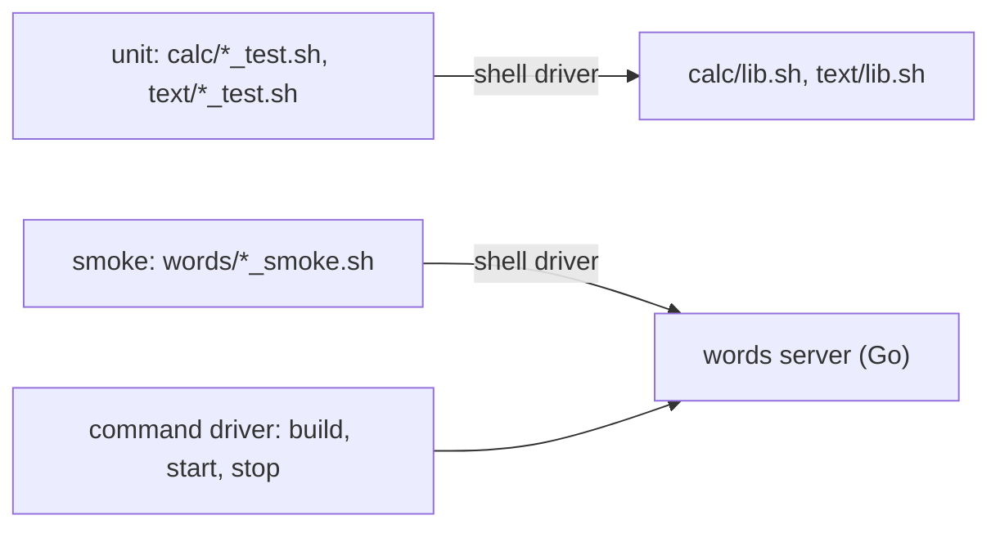

# The example

A small repository the book and pipelinegen's own tests use: a few shell
libraries with their tests, and a Go server with smoke tests against it.
Its tests are shell scripts on purpose: it shows a suite that pipelinegen
binds through the Bazel graph and runs by drivers, with no Go tests and no
task file of its own.

`pipelinegen.yaml` says how each suite runs: the shell driver runs each
test file's `test_` functions, and the command driver, built into
pipelinegen, builds the words server once per build of the smoke suite
and starts it for each batch. On your machine, `pipelinegen slice run
--suite unit` and `pipelinegen slice run --suite smoke` run them as CI does,
with the shell driver in `tools/plugins/shell`, fetched from its pinned
release when it isn't there; `pipelinegen run --all` runs them in their
images, with Docker or Podman. The book's
[tutorial](../docs/tutorial/README.md) starts from a larger sample, and
[moving a suite to drivers](../docs/how-to/moving-to-drivers.md) walks
through this one's smoke suite.
